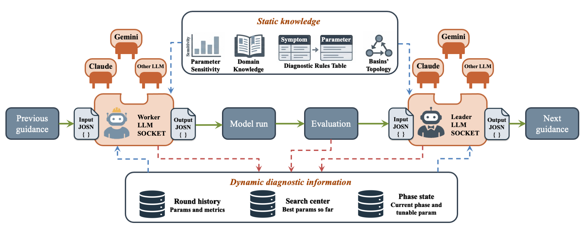
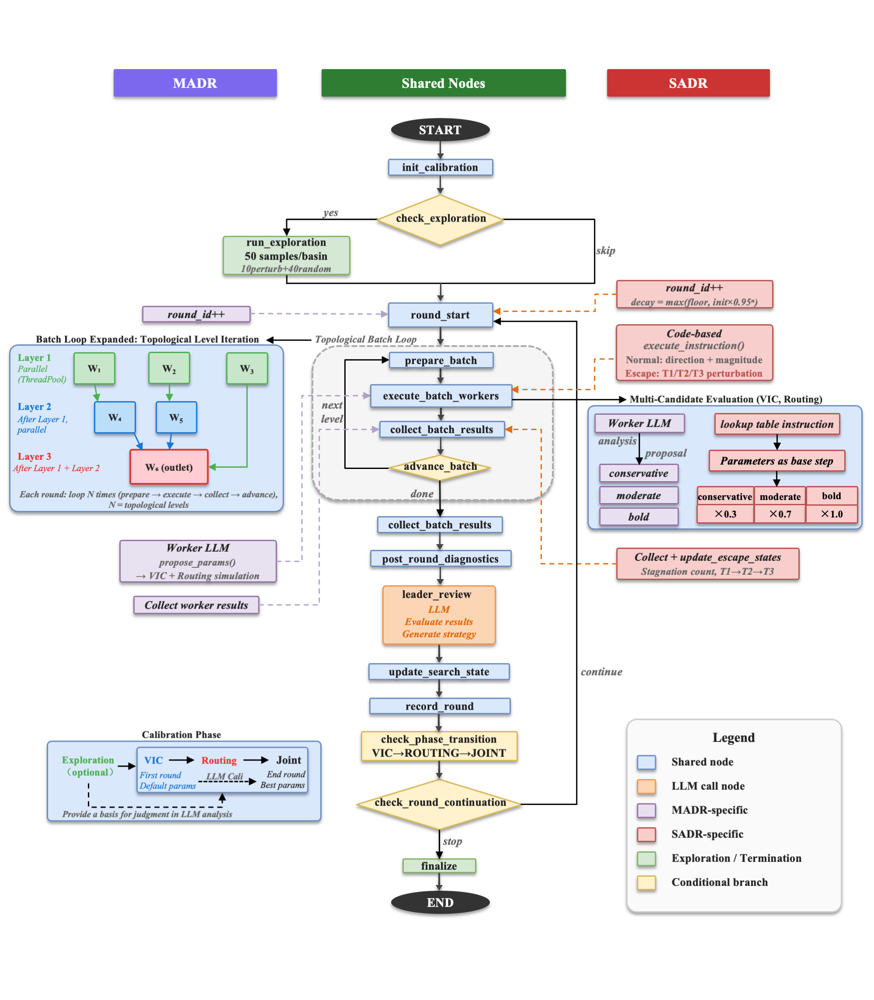

# MADR-final — Multi-Agent Diagnostic Reasoning (3-model build, HTTP API providers)

A LangGraph-based multi-agent framework for calibrating distributed
hydrological models. One **Leader** agent coordinates per-sub-basin **Worker**
agents through a phased calibration loop with patience-based early termination
and a mandatory force-best final round.

This is the **consolidated final build** with three independently-validated
model combinations slotted behind a single pluggable model layer:

| Combination | Land surface | Routing | Phases | Tunable params |
|---|---|---|---|---|
| `vic_routing` | [VIC 5.1](https://github.com/UW-Hydro/VIC) | Lohmann (Fortran source in [`routing/`](../routing/)) | `VIC_ONLY → ROUTING_ONLY → JOINT` | 6 soil + 2 routing = 8 |
| `vic_cama_flood` | [VIC 5.1](https://github.com/UW-Hydro/VIC) | [CaMa-Flood v4.20](https://github.com/global-hydrodynamics/CaMa-Flood_v4) | `VIC_ONLY → CAMA_FLOOD_ONLY → JOINT` | 6 soil + 4 channel = 10 |
| `swat` | [SWAT+](https://swatplus.gitbook.io/docs) (integrated) | (built-in) | `SWATPLUS_HRU` | 18 (HRU + groundwater + snow) |

Each combination has its own prompts subfolder (`prompts/<combo>/`) and its
own executor (`scripts/executors/<combo>.py`). The same `graph_nodes.py`
loop drives all three; combination differences live behind the
`ModelExecutor` ABC.

This is the **HTTP API variant**: LLM calls go through the provider's
native SDK (`anthropic`, `openai`, `gemini`, `deepseek`, `kimi`, `qwen`,
`minimax`). No `claude` CLI binary required; auth is via per-provider
environment variables (e.g. `ANTHROPIC_API_KEY`). For a Claude-Code-CLI
build of the same code, see the sibling **MADR-final-CLI** tree.

---

## Framework overview

The MADR framework treats both the hydrological model and the LLM provider as pluggable. Three model combinations ship today; new ones are added by dropping in a `ModelExecutor` subclass plus a `prompts/<combination>/` folder.



The LangGraph node-level workflow (Worker activation → simulation → diagnostics → Leader review → patience check → next round / finalize) is identical across combinations:



---

## Quick start

```bash
# Activate Python env
source /path/to/your/python_env/bin/activate

pip install langgraph anthropic numpy pandas

# Set your provider API key:
export ANTHROPIC_API_KEY="sk-ant-..."

cd MADR-final

# Simulate-mode smoke tests (no external binaries needed; dry-run skips LLM):
python -m scripts.run_langgraph \
    --team-config configs/swat_yellow.json \
    --output-root /tmp/smoke_swat --dry-run

python -m scripts.run_langgraph \
    --team-config configs/vic_cama_flood_songhua.json \
    --output-root /tmp/smoke_cama --dry-run
```

Each should finish in ~30 s with exit code 0 and write `final_summary.json`.

---

## Architecture

### Selector

Each run config carries one field that picks the combination:

```jsonc
{
  "model_combination": "vic_routing"     // or "vic_cama_flood" or "swat"
}
```

Default is `"vic_routing"` if the field is omitted — pre-multimodel configs
keep working with no edits.

### Two things switch on the combination

1. **Prompts** — `prompts/<combination>/` holds the leader and worker prompts
   plus the parameter-knowledge files for that combination. `prompt_loader.py`
   resolves the path; agents load from there.

2. **Executor** — `scripts/executors/<combination>.py` runs the actual model
   pipeline. The `make_executor(combination, mode)` factory hands
   `graph_nodes.py` the right one. The factory speaks an ABC
   (`ModelExecutor`) so adding a fourth combination is a single new file +
   factory entry + prompts subfolder + `param_validator.py` registration.

```text
prompts/
├── vic_routing/                       6 files: leader_system / leader_review / worker_system /
├── vic_cama_flood/                    worker_propose / param_knowledge_leader / param_knowledge_worker
└── swat/

scripts/
├── prompt_loader.py                   resolve_prompts_dir(combination)
├── executors/
│   ├── __init__.py                    ModelExecutor ABC + make_executor() factory
│   ├── vic_routing.py                 wraps vic_executor.py + Lohmann
│   ├── vic_cama_flood.py              VIC + CaMa-Flood namelist + MAIN_cmf
│   └── swat.py                        wraps swatplus_executor.py + swatplus_runner.py
├── vic_executor.py / vic_runner.py    VIC simulate + real (used by 2 combos)
├── swatplus_executor.py               SWAT+ simulate + real (used by swat combo)
├── swatplus_runner.py
└── ... (shared infrastructure)
```

### Phase pipeline per combination

| Combination | Default pipeline |
|---|---|
| `vic_routing` | `VIC_ONLY (≤80) → ROUTING_ONLY (≤30) → JOINT (≤10)` |
| `vic_cama_flood` | `VIC_ONLY (≤80) → CAMA_FLOOD_ONLY (≤30) → JOINT (≤10)` |
| `swat` | `SWATPLUS_HRU (≤90)` |

Each phase has its own `patience_rounds` config; the phase ends as soon as
mean sub-basin NSE plateaus for that many consecutive rounds outside the MC
window. The mandatory force-best final round runs after the last phase
finishes.

### Calibrated parameters per combination

| Combo | Phase | Tunable | Locked |
|---|---|---|---|
| `vic_routing` | VIC_ONLY | binfilt, Ds, Dsmax, Ws, soil_d2, soil_d3 | velocity, diffusivity |
| | ROUTING_ONLY | velocity, diffusivity | (the 6 VIC) |
| | JOINT | all 8 | — |
| `vic_cama_flood` | VIC_ONLY | binfilt, Ds, Dsmax, Ws, soil_d2, soil_d3 | Hc, Hmin, Wc, Wmin |
| | CAMA_FLOOD_ONLY | Hc, Hmin, Wc, Wmin | (the 6 VIC) |
| | JOINT | all 10 | — |
| `swat` | SWATPLUS_HRU | cn2, esco, awc, surlag, lat_ttime, canmx, epco, perco, alpha, revap_co, revap_min, flo_min, deep_seep, snofall_tmp, snomelt_tmp, snomelt_max, snomelt_min, snomelt_lag | — |

CaMa-Flood channel-parameter ranges:

| Param | Range | Meaning | Default (locked phases) |
|---|---|---|---|
| `Hc` | 0.01 – 1 | Channel-depth coefficient (`H = max(Hmin, Hc·Qave^0.5)`) | 0.1 |
| `Hmin` | 0.5 – 2 | Minimum channel depth (m) | 1.0 |
| `Wc` | 0.1 – 4 | Channel-width coefficient (`W = max(Wmin, Wc·Qave^0.6)`) | 2.5 |
| `Wmin` | 1 – 10 | Minimum channel width (m) | 5.0 |

Power exponents `Hp=0.5`, `Wp=0.6` and offsets `Ho=Wo=0` are not
calibrated.

---

## Configuration

### Common config fields (all combinations)

```jsonc
{
  "run_name": "...",
  "model_combination": "vic_routing",        // selects prompt set + executor
  "model_binding": {"mode": "real"},         // "real" | "simulate"
  "outlet_subbasin_id": "bengbu",

  "phase_config": {
    "pipeline": [
      {"name": "VIC_ONLY", "max_rounds": 80, "mc_rounds": 11, "mc_candidates": 3, "patience_rounds": 10},
      // ...
    ]
  },

  "param_ranges": { "binfilt": [0.001, 0.4], ... },

  "leader":  {"agent_id": "leader", "model": "claude-sonnet-4-6", "provider": "anthropic", "api_key_env": "ANTHROPIC_API_KEY", ...},
  "workers": [{"agent_id": "worker_bengbu", "subbasin_id": "bengbu", ...}, ...]
}
```

### Per-combo additional fields

#### `vic_routing`

Standard VIC fields per worker: `soil_base`, `global_base`, `obs_file`,
`rout_template_dir`, `vic_exe`, `rout_exe`, `flux_prefix`.

#### `vic_cama_flood`

VIC fields above, **plus** a `cama_flood_config` block (top-level, with
per-worker overrides allowed):

```jsonc
"cama_flood_config": {
  "cmf_pkg_dir":   "/abs/path/to/cmf_v420_pkg",
  "basin_map":     "bengbu_15min",
  "diminfo":       "diminfo_bengbu_025deg.txt",
  "forcing_dir":   "/abs/path/to/inp/huaihe",
  "forcing_var":   "Runoff",
  "forcing_prefix": "huaihe_runoff_1d",
  "converter_script": "/abs/path/to/skills/cama-flood-run/vic_post/process_data_windows_ymd.py",
  "converter_args": [],
  "outlet": {"ix": 12, "iy": 8},
  "obs_file": "/abs/path/to/bengbu_obs.csv",
  "start_year": 1990, "end_year": 1996,
  "manning_river": 0.03, "manning_floodplain": 0.10,
  "omp_threads": 16
}
```

A per-worker `"cama_flood_config": {...}` block in a worker entry overrides
the top-level defaults for that station (useful for multi-basin runs where
each station has its own map / outlet / observations).

#### `swat`

SWAT+ fields per worker: `txtinout_template`, `swatplus_exe`, `obs_file`,
`hru_fids`, `subbasin_attrs_file`, `channel_id`. Optionally `swatplus_scratch_dir`
at top level if your `output_root` lives on a slow disk and you want per-run
TxtInOut copies on a local SSD.

---

## CLI options

```
--team-config PATH    Path to the team JSON. Required.
--output-root PATH    One-off output dir.
--result-repo PATH    Repo path; a timestamped subfolder is created.
--run-name NAME       Appended to the timestamped subfolder name.
--dry-run             Skip LLM calls; use rule-based fallback.
--max-rounds N        Override the pipeline's total max_rounds (0 = use config).
--resume              Resume from the latest LangGraph checkpoint.
--log-level LEVEL     DEBUG / INFO / WARNING / ERROR. Default INFO.
```

---

## Output structure

Per round:

```text
round_NNN/
├── leader_decision.md                      J_total / decision / assessment / strategy
├── round_meta.json                         Phase / NSE / tokens / timing
├── messages/                               Per-agent message logs
├── tasks/                                  Per-batch task logs
├── results/
│   ├── worker_<basin>.json                 Winner + full mc_detail
│   ├── worker_<basin>_diagnostic.{json,md} Winner diagnosis
│   ├── worker_<basin>_c1_<label>_diagnostic.{json,md}   Per-candidate (MC rounds only)
│   └── ...
└── routing_result/<basin>/                 Combo-specific per-candidate artefacts
```

Run-level:

```text
run_dir/
├── final_summary.json                      rounds_executed, best_round, J_total, phase_history
├── run_manifest.json                       Config snapshot
├── round_001/, ...
└── cached_vic_*/   (VIC-based combos)      Land-surface flux cache at LAND→ROUTING transition
```

---

## Server deployment notes

### Real-mode `vic_routing`

Needs: VIC 5.1 binary, Lohmann routing binary, per-basin soil/global/routing
template files, observations.

### Real-mode `vic_cama_flood`

In addition to VIC needs:

- Compiled `MAIN_cmf` at `<cmf_pkg_dir>/src/MAIN_cmf`.
- Prepared basin map at `<cmf_pkg_dir>/map/<basin_map>/` (e.g. `bengbu_15min`).
- `process_data_windows_ymd.py` converter (from the `cama-flood-run` skill).
- Outlet `ix / iy` of the gauge cell in the basin grid (lookup from
  `lonlat.bin`).
- Observations CSV with `date` and `Q` columns.

### Real-mode `swat`

Needs:

- Compiled SWAT+ executable.
- TxtInOut template directory per basin.
- Optional: subbasin-attribute CSV for parameter spatial weighting.
- Observations CSV.

### Linux portability

All Python code uses `pathlib.Path` and avoids macOS-only shell idioms.
All LLM calls go through native HTTP SDKs — no external binary dependencies
for the agent layer. Set the appropriate API-key env var per provider:
`ANTHROPIC_API_KEY`, `OPENAI_API_KEY`, `GEMINI_API_KEY`, `DEEPSEEK_API_KEY`,
etc.

---

## File layout

```text
MADR-final/
├── README.md                                this file
├── configs/                                 4 example team configs:
│                                             _template.json, vic_routing_bengbu.json,
│                                             vic_cama_flood_songhua.json, swat_yellow.json
├── docs/
│   ├── framework.png                        framework diagram (used in this README)
│   ├── langgraph_workflow.png               LangGraph node-level diagram
│   └── architecture.md                      multi-model design spec
├── prompts/
│   ├── vic_routing/                         6 files
│   ├── vic_cama_flood/                      6 files
│   └── swat/                                6 files
├── scripts/
│   ├── prompt_loader.py
│   ├── executors/
│   │   ├── __init__.py                      ModelExecutor ABC + factory
│   │   ├── vic_routing.py
│   │   ├── vic_cama_flood.py
│   │   └── swat.py
│   ├── llm_client.py                        anthropic + openai + gemini + deepseek + kimi + qwen + minimax
│   ├── graph_builder.py                     LangGraph wiring
│   ├── graph_nodes.py                       Node functions (combo-agnostic)
│   ├── graph_state.py
│   ├── leader_agent.py / leader_coordinator.py
│   ├── worker_agent.py / worker_state.py / worker_ledger.py / worker_diagnostics.py
│   ├── param_validator.py                   All param-key sets + CalibrationPhase
│   ├── phase_config.py
│   ├── vic_executor.py / vic_runner.py      VIC
│   ├── swatplus_executor.py / swatplus_runner.py   SWAT+
│   ├── initial_explorer.py                  50-sample exploration stage
│   ├── routing_utils.py
│   └── run_langgraph.py                     CLI entry
└── schemas/leader_output.json
```

---

## Two deliverables

| | This tree | Sister tree |
|---|---|---|
| Provider | HTTP only (`anthropic`, `openai`, `gemini`, ...) | `claude_cli` (Claude Code subscription) |
| Folder | `MADR-final/` | `MADR-final-CLI/` |
| Dependencies | API key in env (e.g. `ANTHROPIC_API_KEY`) | + `claude` CLI binary on `$PATH` |
| Use when | Server batch runs with API billing | Local dev with Claude Code subscription quota |

Source code is otherwise byte-identical between the two.

---

## What this build adds over the original (single-model) MADR.cli

| | Before | After |
|---|---|---|
| Combinations | VIC + Lohmann only | VIC + Lohmann, VIC + CaMa-Flood, SWAT+ |
| Prompts | flat `prompts/*` | sharded `prompts/<combination>/*` |
| Model execution | `VICExecutor` direct | `ModelExecutor` ABC + factory + 3 concrete executors |
| Cache helpers | inline in `graph_nodes.py` | per-executor (`cache_intermediates_for_routing` / `clear_intermediate_cache`) |
| Routing artefact copy | inline `_vic_configs.get(sid)` access | `executor.copy_routing_artifacts()` |
| `CalibrationPhase` | 3 values | + `CAMA_FLOOD_ONLY`, `SWATPLUS_HRU` |
| Param key sets | `PARAM_KEYS` + soil + routing | + `CAMA_PARAM_KEYS`, `SWAT_PARAM_KEYS` |

Backward compatibility: existing configs without `model_combination` default
to `"vic_routing"` and produce bit-identical output.


---

## Companion repository components

This `MADR-final/` folder is the multi-model framework. Sister components in the same repository:

- **[`MADR/`](../MADR/)** — Original single-model build (VIC + Lohmann) used in the paper. Same algorithmic logic as `MADR-final` with `model_combination: vic_routing`, but kept separate so paper-reported runs can be reproduced bit-identical from the published configs.
- **[`SADR/`](../SADR/)** — Single-Agent Diagnostic Reasoning ablation. The Leader is retained but the LLM-based Worker is replaced by a deterministic rule-based executor. **Scope: VIC + Lohmann routing only.** SADR exists as the paper's ablation control against MADR and is not extended to other model combinations. For real applications, use MADR.
- **[`routing/`](../routing/)** — Lohmann routing model Fortran source with local modifications and a Makefile.

---

## Roadmap

The pluggable executor architecture is designed for incremental growth. New model combinations are added by:

1. Creating `prompts/<new_combination>/` (6 files: leader_system, leader_review, worker_system, worker_propose, param_knowledge_leader, param_knowledge_worker).
2. Implementing `scripts/executors/<new_combination>.py` as a `ModelExecutor` subclass.
3. Registering the new combination in `scripts/executors/__init__.py`'s factory.
4. Adding any model-specific runner (e.g. `swatplus_runner.py`, `vic_runner.py`).
5. Adding a sample config under `configs/`.

Planned extensions:

- More hydrological models — **W-FLOW**, **WRF-Hydro**, **XAJ**, **HBV** as additional combinations under the same framework.
- Beyond hydrology — multi-objective optimization in **reservoir dispatching**, **water resource allocation**, and broader Earth-science calibration problems (land-surface, groundwater, coupled Earth-system models).

---

## Citation

If you use this code, please cite the preprint:

> Yichen Zhao, Ziwei Li, Liujun Zhu, Junliang Jin, Jianyun Zhang. *LLM-Driven Diagnostic Reasoning for Distributed Hydrological Model Calibration*. Research Square, Preprint (Version 1), 22 June 2026. https://doi.org/10.21203/rs.3.rs-10106384/v1

### Companion dataset

Observation streamflow, VIC/CaMa-Flood/SWAT+ input files, and all calibration outputs:

> Zhao, Y. (2026). Dataset for "LLM-Driven Diagnostic Reasoning for Distributed Hydrological Model Calibration". Zenodo. https://doi.org/10.5281/zenodo.20622937
