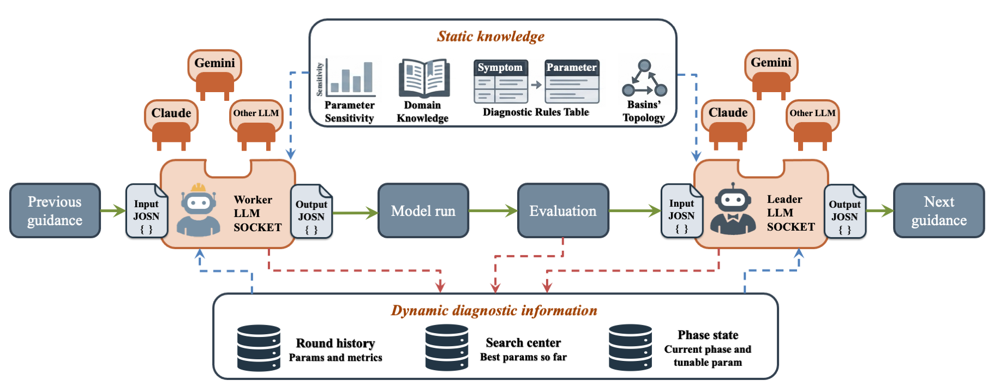
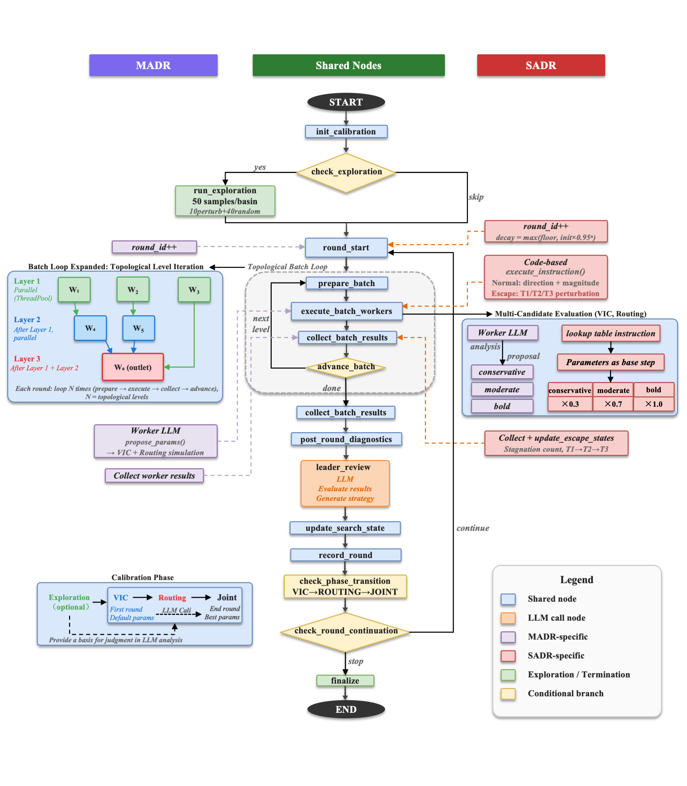

# MADR — Multi-Agent Diagnostic Reasoning for Distributed Hydrological Model Calibration

MADR is an LLM-driven framework for calibrating distributed hydrological models in nested-basin systems. A **Leader Agent** diagnoses cross-station simulation errors and emits structured direction-and-magnitude guidance; per-basin **Worker Agents** translate that guidance into concrete parameter sets. The framework is implemented in [LangGraph](https://github.com/langchain-ai/langgraph), runs through native HTTP SDKs of any major LLM provider, and treats the underlying hydrological model as a pluggable component — three combinations ship today, more can be added in 4 short steps.

📦 **Preprint**: Zhao, Li, Zhu, Jin, Zhang (2026). *LLM-Driven Diagnostic Reasoning for Distributed Hydrological Model Calibration*. Research Square. [10.21203/rs.3.rs-10106384/v1](https://doi.org/10.21203/rs.3.rs-10106384/v1)
📂 **Dataset**: observations, model inputs, all calibration runs, and SCE-UA / NSGA-III benchmarks on Zenodo: [10.5281/zenodo.20622937](https://doi.org/10.5281/zenodo.20622937)

---

## Framework overview

MADR treats both the hydrological model and the LLM provider as pluggable. Three model combinations ship today; new combinations are added by dropping in a `ModelExecutor` subclass plus a `prompts/<combination>/` folder.



The LangGraph node-level workflow (Worker activation → simulation → diagnostics → Leader review → patience check → next round / finalize) is identical across all combinations:



### Supported model combinations

| Combination | Land surface | Routing | Phases | Tunable params |
|---|---|---|---|---|
| `vic_routing` (paper default) | [VIC 5.1](https://github.com/UW-Hydro/VIC) | Lohmann (Fortran source in [`../routing/`](../routing/)) | `VIC_ONLY → ROUTING_ONLY → JOINT` | 6 soil + 2 routing = 8 |
| `vic_cama_flood` | [VIC 5.1](https://github.com/UW-Hydro/VIC) | [CaMa-Flood v4.20](https://github.com/global-hydrodynamics/CaMa-Flood_v4) | `VIC_ONLY → CAMA_FLOOD_ONLY → JOINT` | 6 soil + 4 channel = 10 |
| `swat` | [SWAT+](https://swatplus.gitbook.io/docs) (integrated land + routing) | (built-in) | `SWATPLUS_HRU` | 18 (HRU + groundwater + snow) |

---

## What makes MADR distinct

Three characteristics define the framework:

1. **Three sources of knowledge** inform diagnostic reasoning at every round — the LLM's pretrained domain knowledge, expert knowledge supplied via prompts and a diagnostic-rules table, and iterative understanding built from per-round simulation feedback.
2. **Dynamic information exchange** among agents, both within a single round (downstream Workers see upstream Workers' fresh parameter decisions) and across rounds (the Leader's per-basin guidance evolves with the search trajectory), continually updates the parameter search.
3. **Phased decomposition** divides calibration into successive stages over tractable parameter subspaces, allowing the LLM to focus on a coherent parameter group at lower effective dimensionality.

### Leader / Worker division

Producing **global guidance** and proposing **per-basin parameter values** both draw on pretrained knowledge, expert input, and per-round feedback — but each emphasizes a different aspect. Global guidance emphasizes relationships among sub-basins and how their upstream–downstream interactions determine overall performance. Per-basin proposals emphasize each sub-basin's own performance history, diagnostic signals, and the latest information transmitted from its upstream neighbors. MADR separates these into two coordinated roles:

- **Leader Agent** — the global-view agent. Activated once at the end of each round to consolidate cross-basin information, perform coordinated diagnostic reasoning over the basins' upstream–downstream topology, and emit per-basin direction-and-magnitude guidance for the next round. The Leader does **not** directly produce parameter values.
- **Worker Agents** — N local-view agents (one per sub-basin). Each Worker is activated at the start of each round to propose the parameter set for that round's simulation, using the Leader's per-basin guidance plus the sub-basin's local history and diagnostic information.

```
                                    ┌─→ Worker xixian    ─→ Model run
                                    ├─→ Worker wangjiaba ─→ Model run
Leader (per-round global diagnosis) ┼─→ Worker jiangjiaji ─→ Model run
                                    ├─→ Worker zhoukou   ─→ Model run
                                    └─→ Worker bengbu    ─→ Model run
```

### A MADR round (four steps)

1. **Worker activation** — The N Worker Agents are invoked in topological order, headwater Workers first. Each Worker uses the Leader's guidance from the previous round to propose parameters for its own sub-basin.
2. **Simulation** — The proposed parameters drive the model combination selected for the run (VIC + Lohmann, VIC + CaMa-Flood, or SWAT+) across the coupled multi-basin system.
3. **Evaluation** — Simulated streamflow is scored with overall objectives, statistical metrics (NSE, KGE, PBIAS, RMSE), and process signatures (peak ratio, peak timing bias, recession K ratio, etc.).
4. **Leader review** — The Leader conducts a global diagnosis of all sub-basin results, identifies cross-basin patterns and bottlenecks, and emits guidance for the next round.

### Worker coordination

Three mechanisms keep coordinated Workers consistent:

- **Topological processing** — Workers are partitioned into topological levels (Kahn's algorithm); all Workers in one level finish before any Worker in the next level begins; Workers within the same level run in parallel.
- **Information exchange** — Once an upstream Worker has proposed its parameters, those values are written into the upstream cells of each downstream sub-basin's hydrological model, so the downstream simulation runs against the most recent upstream state. The downstream Worker sees these upstream effects implicitly, through its own sub-basin's simulation outputs.
- **Parameter locking** — When a downstream Worker proposes its parameters, the values already chosen by its upstream Workers in the same round are held fixed and cannot be revised.

---

## Calibration strategy

MADR runs an **Exploration Stage** followed by **sequential agent phases** (number and content depending on the combination — see the table above). Each phase ends as soon as either of two conditions fires:

1. **Patience-based early termination** (the recommended trigger) — the in-phase mean sub-basin NSE has not improved for `patience_rounds` consecutive **single-candidate** rounds. Multi-candidate rounds are excluded from the counter so aggressive exploration does not trip the trigger.
2. **`max_rounds` cap** — a hard upper bound that always applies, providing a safety ceiling on per-phase cost.

This adaptive behavior is the headline of the current build: each phase now stops as soon as it plateaus, instead of always running to its full round budget. The paper's reported runs can still be reproduced exactly — see *Reproducing the paper's fixed-budget runs* below.

- **Exploration Stage** (before Agent Rounds): 50 simulations per sub-basin (10 Gaussian perturbations around the configured default + 40 Latin Hypercube samples). The per-sub-basin summary (best NSE, top-five NSE, best parameter combination) is injected into every Worker's prompt as a fixed contextual reference and shown to the Leader once at Round 1. The exploration provides **soft contextual evidence** to the LLMs; it does **not** modify the initial parameter center or the search radius.

- **Three sequential Agent Phases** for `vic_routing` (the paper's canonical setup) with both a per-phase cap and a recommended patience trigger:

  | Phase | `max_rounds` (cap) | `patience_rounds` (recommended) | Parameters | Notes |
  |---|---|---|---|---|
  | **VIC-Only** | 50 | 10 | 6 soil params (binfilt, Ds, Dsmax, Ws, soil_d2, soil_d3) | Routing held at defaults |
  | **Routing-Only** | 30 | 5 | velocity, diffusivity | VIC held at search center from VIC-Only |
  | **Joint** | 10 | 3 | All 8 | Fine-tunes from end of Routing-Only |

- **Multi-candidate generation** (early rounds of VIC-Only and Routing-Only — first 11 and first 5 respectively): every Worker is invoked three times with distinct strategy tags (`conservative`, `moderate`, `bold`); the three candidate parameter sets are simulated and the one achieving the highest NSE is adopted as that round's proposal.
- **Round 1 special case**: the Worker LLM is not invoked. The model runs with the configured default parameters, providing the baseline against which the Leader's first guidance is issued.
- **Final round (force-best)**: once the last phase ends — whether by patience or by hitting its `max_rounds` cap — MADR runs one mandatory final round in which each Worker uses its own per-sub-basin best historical parameters. This delivers a clean end-state composite for downstream use.

Recommended pipeline (patience enabled):

```jsonc
"phase_config": {
  "pipeline": [
    {"name": "VIC_ONLY",     "max_rounds": 50, "mc_rounds": 11, "mc_candidates": 3, "patience_rounds": 10},
    {"name": "ROUTING_ONLY", "max_rounds": 30, "mc_rounds":  5, "mc_candidates": 3, "patience_rounds":  5},
    {"name": "JOINT",        "max_rounds": 10, "mc_rounds":  0, "mc_candidates": 0, "patience_rounds":  3}
  ]
}
```

**Evaluation budget per sub-basin.** With patience enabled, each MADR run typically converges in **roughly 110–150 model evaluations per sub-basin**, depending on how quickly each phase plateaus. With patience disabled, the budget is the fixed **170 evaluations** used in the paper.

#### Reproducing the paper's fixed-budget runs

The paper's reported numbers use the legacy fixed-budget configuration: each phase runs to its full `max_rounds` regardless of plateau, giving exactly **170 evaluations per sub-basin** (50 Exploration + 120 across 90 Agent Rounds = 75 single-candidate × 1 + 15 multi-candidate × 3). To reproduce, omit `patience_rounds` from every phase (or set it to `999` to disable the trigger).

---

## Case study: VIC + Lohmann on the Huai River basin (paper setup)

The paper validates MADR on the catchment upstream of Bengbu gauging station in the Huai River basin (121,330 km²), with **five nested control stations**: Xixian (XX) → Wangjiaba (WJB) → Bengbu (BB) on the main stem, with Zhoukou (ZK) and Jiangjiaji (JJJ) on tributaries entering between WJB and BB. The example config [`configs/vic_routing_bengbu.json`](configs/vic_routing_bengbu.json) reproduces this setup.

- **Calibration period**: 1981–1990 (1980 spin-up)
- **Validation period**: 1991–1996 (independent transferability test)
- **Per-basin budget**: 170 model evaluations (50 Exploration + 120 Agent Rounds)
- **LLMs tested**: Claude Sonnet 4.6, Gemini 3 Flash Preview — both reach the optimization benchmarks' accuracy at < 5% of their 4000-evaluation budget; MADR also exhibits smaller validation-period NSE reductions.

The dataset (observations + VIC/Lohmann inputs + 10 × MADR runs × 2 LLMs + SCE-UA + NSGA-III outputs) is on Zenodo at the DOI above.

---

## Quick Start

### Prerequisites

- Python 3.10+
- The compiled binary for whichever combination you intend to use:
  - **VIC + Lohmann**: [VIC 5.1](https://github.com/UW-Hydro/VIC) executable + the Lohmann routing executable from [`../routing/`](../routing/) (build with `make`)
  - **VIC + CaMa-Flood**: VIC 5.1 + [CaMa-Flood v4.20](https://github.com/global-hydrodynamics/CaMa-Flood_v4) `MAIN_cmf`
  - **SWAT+**: a compiled [SWAT+](https://swatplus.gitbook.io/docs) executable
- Forcing, soil, vegetation, and routing input files (the paper's are bundled in the Zenodo dataset)

### Install Python dependencies

```bash
pip install langgraph anthropic
# Add the SDKs for any other LLM providers you intend to use:
# pip install google-genai           # Gemini
# pip install openai httpx           # OpenAI / DeepSeek / Grok / Kimi
```

### Set your LLM API key

```bash
export ANTHROPIC_API_KEY="your-key"    # default in the shipped configs
# Or one of:
# export GEMINI_API_KEY="your-key"
# export OPENAI_API_KEY="your-key"
# export DEEPSEEK_API_KEY="your-key"
# export GROK_API_KEY="your-key"
# export KIMI_API_KEY="your-key"
```

### Replace local paths in the config

The shipped configs contain the original author's absolute paths to executables and data. **You must replace them before running.** Every config includes a top-level `_path_replacement_notice` field flagging this. Search-and-replace `/Users/yc/cowork/framework/` (and similar prefixes) with your local data root.

### Run

```bash
cd MADR

# VIC + Lohmann (paper default)
python -m scripts.run_langgraph \
    --team-config configs/vic_routing_bengbu.json \
    --output-root ./output

# VIC + CaMa-Flood
python -m scripts.run_langgraph \
    --team-config configs/vic_cama_flood_songhua.json \
    --output-root ./output

# SWAT+
python -m scripts.run_langgraph \
    --team-config configs/swat_yellow.json \
    --output-root ./output
```

### CLI options

```
--team-config PATH    Path to the config JSON (required)
--output-root PATH    Output directory
--result-repo PATH    Result repo (auto-creates a timestamped subfolder)
--run-name NAME       Run name appended to the output folder
--resume              Resume from the latest checkpoint
--dry-run             Skip LLM calls; use rule-based fallback
--max-rounds N        Override max rounds (0 = use pipeline sum)
--log-level LEVEL     DEBUG, INFO, WARNING, ERROR
--thread-id ID        Thread ID for checkpoint tracking (default: "default")
```

---

## Configuration

The `configs/` folder ships four examples:

| File | Combination | Purpose |
|---|---|---|
| `_template.json` | (any) | Annotated master template — every top-level field documented inline via `_doc_*` keys |
| `vic_routing_bengbu.json` | `vic_routing` | Paper's Huai River 5-basin setup (Bengbu outlet) |
| `vic_cama_flood_songhua.json` | `vic_cama_flood` | Songhua River nested pair (Jiangqiao → Jiamusi) — real-mode CaMa-Flood pipeline |
| `swat_yellow.json` | `swat` | Yellow River Tangnaihai → Lanzhou (single-phase SWATPLUS_HRU calibration) |

### Adding a new model combination

The pluggable executor architecture is designed for incremental growth. To add a new combination:

1. Create `prompts/<new_combination>/` with the 6-file shape (`leader_system`, `leader_review`, `worker_system`, `worker_propose`, `param_knowledge_leader`, `param_knowledge_worker`).
2. Implement `scripts/executors/<new_combination>.py` as a `ModelExecutor` subclass (`run`, `cache_intermediates_for_routing`, `clear_intermediate_cache`, `tunable_keys_by_phase`).
3. Register it in `scripts/executors/__init__.py`'s `make_executor()` factory.
4. Add a sample config under `configs/` with `"model_combination": "<new_combination>"`.

See [`docs/architecture.md`](docs/architecture.md) for the design rationale and ABC surface in detail.

---

## Switching LLM Providers

All tested providers are supported by `scripts/llm_client.py` out of the box — change `model`, `provider`, and `api_key_env` in the config; no code changes required. Provider-specific quirks (GPT-5.x / o-series `max_completion_tokens`, Kimi K2.6 temperature/min-tokens, Kimi/Qwen proxy bypass) are handled automatically.

| Provider | Example Leader / Worker Model | API Key Env Var | `timeout_sec` | SDK |
|---|---|---|---|---|
| **Claude** (default) | `claude-sonnet-4-6` | `ANTHROPIC_API_KEY` | 240 | `pip install anthropic` |
| **Gemini** | `gemini-2.5-flash` (or `gemini-3-flash-preview`) | `GEMINI_API_KEY` | 240 | `pip install google-genai` |
| **OpenAI** | `gpt-5.4` / `gpt-5.4-mini` | `OPENAI_API_KEY` | 240 | `pip install openai` |
| **DeepSeek** | `deepseek-v4-pro` / `deepseek-v4-flash` | `DEEPSEEK_API_KEY` | 240 | `pip install openai` |
| **Kimi** (Moonshot) | `kimi-k2.6` | `KIMI_API_KEY` | **300** | `pip install openai httpx` |
| **Qwen** (DashScope) | `qwen3-max` | `DASHSCOPE_API_KEY` | 240 | `pip install openai` |
| **MiniMax** | `MiniMax-M2.5` | `MINIMAX_API_KEY` | 240 | `pip install anthropic` |

Example: switch from Claude to Gemini in a config:

```jsonc
"leader": {
  "model": "gemini-2.5-flash",
  "provider": "gemini",
  "api_key_env": "GEMINI_API_KEY",
  "temperature": 0.3, "max_tokens": 8192, "timeout_sec": 240.0
}
```

For multi-agent (MADR) runs, repeat the same swap inside every `workers[]` entry. For SADR (Leader-only ablation, see below), only the `leader` block changes.

---

## File layout

```text
MADR/
├── README.md                                this file
├── configs/                                 4 example team configs
│                                              _template.json, vic_routing_bengbu.json,
│                                              vic_cama_flood_songhua.json, swat_yellow.json
├── prompts/
│   ├── vic_routing/                         6 files
│   ├── vic_cama_flood/                      6 files
│   └── swat/                                6 files
├── schemas/leader_output.json               JSON schema for Leader output
├── scripts/
│   ├── run_langgraph.py                     CLI entry point
│   ├── graph_builder.py                     LangGraph graph construction
│   ├── graph_nodes.py                       Node functions (model-agnostic)
│   ├── graph_state.py                       State definition (TypedDict)
│   ├── prompt_loader.py                     Resolves prompts/<combination>/
│   ├── executors/
│   │   ├── __init__.py                      ModelExecutor ABC + make_executor() factory
│   │   ├── vic_routing.py                   VIC + Lohmann
│   │   ├── vic_cama_flood.py                VIC + CaMa-Flood
│   │   └── swat.py                          SWAT+
│   ├── llm_client.py                        Multi-provider client (anthropic, openai, gemini,
│   │                                          deepseek, kimi, qwen, minimax)
│   ├── leader_agent.py                      Leader agent logic
│   ├── leader_coordinator.py                Leader coordination utilities
│   ├── worker_agent.py                      Worker agent logic
│   ├── worker_state.py / worker_ledger.py   Per-Worker state and history
│   ├── worker_diagnostics.py                NSE, PBIAS, peak metrics, etc.
│   ├── initial_explorer.py                  Exploration Stage
│   ├── phase_config.py                      Phase management (patience + max_rounds)
│   ├── param_validator.py                   Parameter bounds validation
│   ├── routing_utils.py                     Routing model utilities
│   ├── vic_executor.py / vic_runner.py      VIC simulate + real
│   ├── swatplus_executor.py / swatplus_runner.py   SWAT+
│   └── context_manager.py                   Context / memory management
└── docs/
    ├── framework.png                        framework diagram (used in this README)
    ├── langgraph_workflow.png               LangGraph node-level diagram
    └── architecture.md                      multi-model design spec
```

---

## SADR — single-agent ablation

The sibling `../SADR/` folder contains the **Single-Agent Diagnostic Reasoning** ablation used in the paper. SADR retains MADR's Leader-Worker structure but replaces the LLM-based Worker with a deterministic rule-based code executor, so LLM-driven diagnostic reasoning occurs only at the Leader level.

- **Scope**: VIC + Lohmann routing only. SADR is **not** extended to other model combinations.
- **Use**: ablation control to isolate the contribution of the LLM-based Worker. For real applications use MADR.
- **Same per-sub-basin budget** as MADR (170 evaluations) so the comparison is apples-to-apples.

---

## Roadmap

The pluggable-executor architecture is built for incremental growth.

**Hydrological models.** Beyond `vic_routing`, `vic_cama_flood`, and `swat`, we plan to add:

- **wflow** (Deltares)
- **WRF-Hydro**
- **XAJ** (Xinanjiang)
- **HBV**

Each is a new combination dropped in via 4 files (prompts × 4) + 1 executor — see *Adding a new model combination* above.

**Beyond hydrology.** The multi-agent diagnostic-reasoning pattern generalizes to other multi-objective optimization problems in the Earth and water sciences:

- **Reservoir dispatching** — balancing flood control, water supply, hydropower, and ecological flow objectives across cascaded reservoirs.
- **Water resource allocation** — coordinating allocations across competing demands, regions, and basins.
- **Other Earth-science calibration problems** — land-surface, groundwater, and coupled Earth-system models, where process-level diagnostic signals can guide LLM-driven parameter tuning under multi-objective trade-offs.

---

## Citation

If you use this code, please cite the preprint:

> Yichen Zhao, Ziwei Li, Liujun Zhu, Junliang Jin, Jianyun Zhang. *LLM-Driven Diagnostic Reasoning for Distributed Hydrological Model Calibration*. Research Square, Preprint (Version 1), 22 June 2026. https://doi.org/10.21203/rs.3.rs-10106384/v1

### Companion dataset

> Zhao, Y. (2026). Dataset for "LLM-Driven Diagnostic Reasoning for Distributed Hydrological Model Calibration". Zenodo. https://doi.org/10.5281/zenodo.20622937
