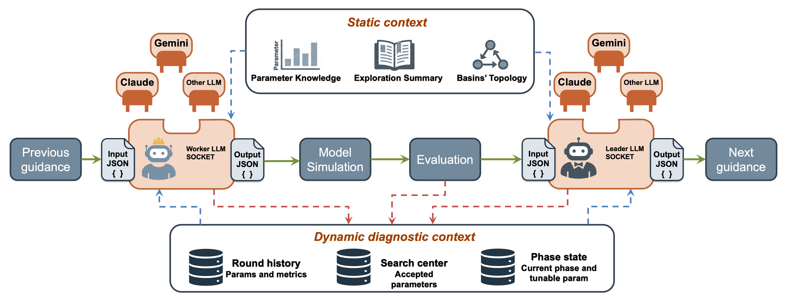
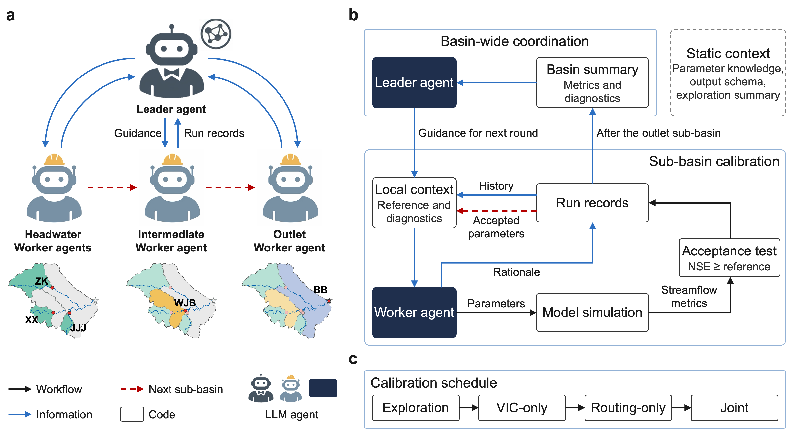

# MADR — revision

MADR calibrates distributed hydrological models in nested basins using a global Leader LLM and one Worker LLM per sub-basin. The Leader coordinates station-level adjustments; Workers propose parameter values using simulation evidence, conditional code-generated advice, and supplied physical knowledge.

This source package implements **three-layer VIC with ARNO baseflow and Lohmann routing**. It also provides **SADR**, which uses the same Leader and execution framework but replaces Worker LLM proposals with a rule-based policy; see [SADR/](SADR/README.md) for how to run it. Model executables, basin inputs, observations, and API credentials are supplied separately.

## LLM interfaces and context

Leader and Worker are stateless calls with fixed prompts and structured JSON output
contracts. Static parameter knowledge, exploration summaries, and basin topology
are combined with dynamic round history, accepted centers, and phase state. Code
assembles this context from saved records; the API profile selects the LLM provider.
Conditional diagnostic hints support the agents' reasoning, while code handles
physical constraints, simulation, and acceptance.



## Workflow

Workers operate in upstream-to-downstream order using the previous round's Leader
guidance, local history, and a measured reference under the current accepted
upstream parameters. Verified identical-input references can be reused. Each Worker
proposes phase-allowed candidates; code runs the simulations, selects the candidate
with the highest NSE, and compares it with the same-background reference. The
accepted centers and round-end diagnostic evidence feed the Leader's next-round
review. Initial exploration supplies context. After VIC-only, routing-only, and
joint calibration, a final round confirms the selected complete parameter vector.
SADR uses the same cycle with rule-based Worker proposals.



The [comparison catalog](ablations/README.md) lists the ablations, including S3, which
replaces the Leader–Worker organization with one global agent.

## Quick start

The code requires Linux, Python 3.12, the packages in [requirements.txt](requirements.txt), and compatible VIC and routing executables; the routing executable `rout` can be built from [routing/](routing/README.md). It was tested on Linux x86_64 with Python 3.12.3 and the versions pinned in [MADR/tools/requirements-linux.txt](MADR/tools/requirements-linux.txt).

1. Prepare an input binding using [MADR/configs/input_binding.example.json](MADR/configs/input_binding.example.json). Replace its placeholders with your model-input and executable paths.
2. Edit [MADR/configs/settings.json](MADR/configs/settings.json) to set the binding file and output directory. `key_file` is optional: point it to a file of `NAME=value` lines for the API keys, or delete the entry when the keys come from the environment.
3. Select a launch configuration: [MADR/configs/MADR_run.json](MADR/configs/MADR_run.json) runs MADR and [MADR/configs/SADR_run.json](MADR/configs/SADR_run.json) runs SADR. Give each independent run a unique `run_name` in the launch file and distinct `random_seed` and `initial_exploration.seed` values in the configuration file named by `team_config`.
4. Supply `ANTHROPIC_API_KEY` (default profile), `GEMINI_API_KEY`, or `DEEPSEEK_API_KEY` through the environment or an external assignment file. Never put credentials in tracked JSON files.

Run these commands from the `MADR/` directory:

```bash
python -B tools/run_madr.py --config configs/MADR_run.json --action validate
python -B tools/run_madr.py --config configs/MADR_run.json --action prepare
python -B tools/run_madr.py --config configs/MADR_run.json --action run
python -B tools/run_madr.py --config configs/MADR_run.json --action summarize
```

`validate` checks configuration and budgets. `prepare` checks physical inputs and creates an isolated workspace and source snapshot. Neither action runs a model or calls an LLM. `run` starts computation using the prepared snapshot; existing run directories are not overwritten. Use a new run name after changing a prepared configuration.

The launch JSON selects an `api_profile`; the supplied configurations use `sonnet_cached` (see [Supported LLMs](#supported-llms)). Model IDs and request settings are defined in [MADR/tools/linux_common.py](MADR/tools/linux_common.py). These profiles use provider-default thinking and omit temperature. `sonnet_cached` enables system-prompt caching. Claude and Gemini requests use the proxy settings of the environment when present; DeepSeek child processes bypass proxies.

## Supported LLMs

Any LLM that returns the required JSON output can serve as the Leader or the Worker. The prompts, schedule, acceptance test, and budget do not change with the model. The launcher provides four profiles:

| `api_profile` | Provider | Model ID | Status |
| --- | --- | --- | --- |
| `sonnet_cached` (default) | Anthropic | `claude-sonnet-5-5` | Used for the reported Claude runs; caches the system prompt |
| `sonnet_default` | Anthropic | `claude-sonnet-5-5` | Same model without prompt caching |
| `gemini_default` | Google | `gemini-3.8-flash` | Used for the reported Gemini runs |
| `ds_default` | DeepSeek | `deepseek-flash` | Configured; not used for the reported results |

Another model from one of these providers needs a new entry in `API_PROFILES` ([MADR/tools/linux_common.py](MADR/tools/linux_common.py)); the batch tools [ablations/make_batch.py](ablations/make_batch.py) and [ablations/run_suite.py](ablations/run_suite.py) also list the accepted profile names. [MADR/scripts/llm_client.py](MADR/scripts/llm_client.py) also contains client adapters for OpenAI, Kimi, Qwen, and MiniMax. They have no launcher profile and were not tested with this release. Enabling one requires at least a profile, an entry in `provider_network_policy` (also in `MADR/tools/linux_common.py`), and its key name in `KEY_NAMES` ([MADR/tools/api_credentials.py](MADR/tools/api_credentials.py)). Token-usage summaries currently parse Anthropic, Gemini, and DeepSeek usage records only.

## Methods and evaluation budget

MADR and SADR share the Leader, metric calculations, physical executor, parameter constraints, phase schedule, acceptance rules, recovery handling, and result selection. SADR's Worker uses guidance-based steps, decay, perturbations, and escape; it makes no Worker LLM calls.

The default per-station budget is **50 exploration evaluations plus 90 main-loop rounds**: 50 VIC-only, 30 routing-only, and 10 joint rounds. Fifteen rounds evaluate three candidates and the other 75 evaluate one, giving **120 main-loop evaluations and 170 base evaluations per station**. The initial default evaluation and final complete-state confirmation are included in this budget.

Downstream proposals are compared against the local center under the same accepted upstream parameters. A verified identical-input result is reused when available; otherwise a center evaluation is added and counted separately. Thus, 170 is the base budget, not a guaranteed total model-call count. Routing-only evaluations reuse fixed VIC fluxes, so candidate evaluations and native executable launches are reported separately.

Run length and phase budgets are controlled by [MADR/configs/MADR_90round.json](MADR/configs/MADR_90round.json) and [MADR/configs/SADR_90round.json](MADR/configs/SADR_90round.json).

Each phase can also end early. Set `patience_rounds` (a positive integer) and, optionally, `patience_min_delta` for a phase in `phase_config.pipeline`: once the basin-mean NSE has not exceeded the best value of that phase by more than `patience_min_delta` for that many rounds, the run moves to the next phase, or to the final confirmation after the last phase. Multi-candidate rounds and rounds with failed evaluations are not counted. The supplied configurations set `patience_rounds` to `null`, so every phase uses its full budget. Stopping at a target NSE is not implemented. Multi-candidate rounds take one to three candidates.

## Configuration and outputs

| Location | Contents |
| --- | --- |
| [MADR/configs/](MADR/configs/) | Launch settings, periods, station topology, parameter bounds, and budgets |
| [MADR/prompts/vic_routing/static_bundle.md](MADR/prompts/vic_routing/static_bundle.md) | Static prompts and physical knowledge read by the agents |
| [MADR/schemas/](MADR/schemas/) | Leader and Worker output contracts |
| [MADR/scripts/](MADR/scripts/) | Shared calibration implementation |
| [MADR/tools/](MADR/tools/) | Input preparation, launch, and usage reporting |
| [SADR/](SADR/README.md) | How SADR runs on the shared code, and its configuration and commands |
| [ablations/](ablations/README.md) | Ablation and sensitivity configurations, including S3 |
| [routing/](routing/README.md) | Lohmann routing source for building the `rout` executable |

Results are stored under `settings.work_root/run_name/runs/run_name/`. The main outputs are `final_summary.json`, `representative_result/`, round-level records, `native_audit/`, and `llm_calls.jsonl`. The final representative result uses **one complete basin-wide parameter set selected by the highest mean station NSE**. It is not a combination of independently selected station optima. `J_total` is recorded separately as Leader feedback.

Each run also keeps a LangGraph checkpoint database, `langgraph_checkpoints.db`, for resuming. It grows quickly with the number of rounds and can exceed 10 GB for a 90-round run. Delete it after a completed run if you do not need to resume.

The five-station configurations are Huaihe examples. For another basin, update station IDs, physical bindings, flux prefixes, the acyclic single-outlet topology, and simulation/evaluation periods together. Station count is configurable. A different hydrological model additionally requires an appropriate executor, parameter contract, and physical knowledge.

## Ablations and sensitivity experiments

The [experiment catalog](ablations/README.md) contains **20 non-baseline configurations**, listed in separate sections:

- MADR structure, information, and procedure comparisons: **S1–S3, I1–I5, P1–P4**.
- MADR budget and phase-allocation comparisons: **H1–H5**.
- SADR auxiliary-policy comparisons: **SADR-E, SADR-D, SADR-ED** (without escape, without decay, and without both).

Nineteen configurations use the shared runtime through an explicit ablation launcher; [S3](ablations/S3_single_global_agent/README.md) has a separate global-agent entry. Ordinary MADR/SADR runs do not activate these adapters and are not included in the count of 20.

The catalog provides the exact identifiers, budgets, and repeated-run commands. The [protocol identifier](ablations/PROTOCOL_VERSIONS.md) binds each label to one implementation. Launch files must use the current protocol version and arm labels.

## Reproducibility

Preparation records source, prompt, configuration, and input fingerprints for the selected run. Fresh runs on another basin do not need to match the example basin's hashes. Exploration reuse requires a compatible complete bundle with matching numerical inputs and design; an isolated text summary is insufficient.

The formal runs used Linux x86_64 with Python 3.12.3, numpy 2.3.5, and the pins in [MADR/tools/requirements-linux.txt](MADR/tools/requirements-linux.txt); the launcher sets `PYTHONHASHSEED=0`. An exploration bundle also records the Python and numpy versions and a hash of the numerical source code. A bundle created under a different environment or code version is not accepted for `reuse`; run a fresh exploration instead.

Failed or invalid LLM responses follow the shared retry/fallback policy. Records distinguish Leader fallbacks, Worker candidate slots supplied by code, and affected rounds. Retain these records, actual evaluation counts, token usage, and the frozen source snapshot with experimental results.

## Paper, data, and license

- [Preprint, Version 1](https://doi.org/10.21203/rs.3.rs-10106384/v1)
- Companion dataset, Version 2: [https://zenodo.org/records/24047339](https://zenodo.org/records/24047339) (DOI [10.5281/zenodo.24047339](https://doi.org/10.5281/zenodo.24047339))
- [MIT License](LICENSE) for the framework; the [`routing/`](routing/README.md) subtree retains its separately documented upstream provenance.
