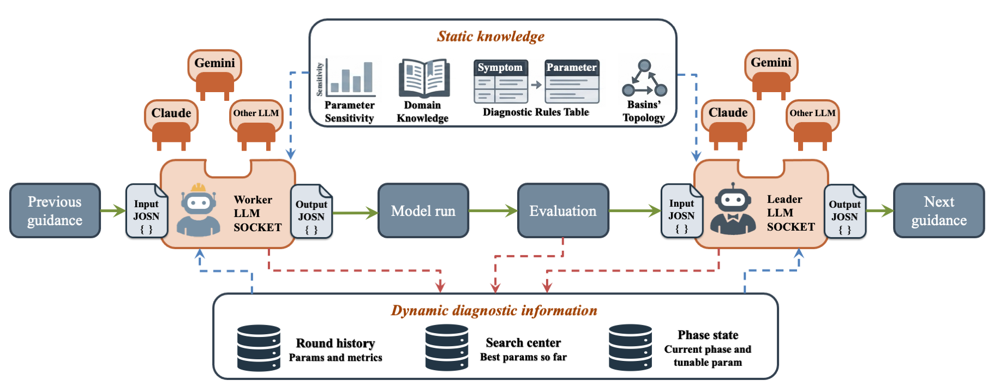
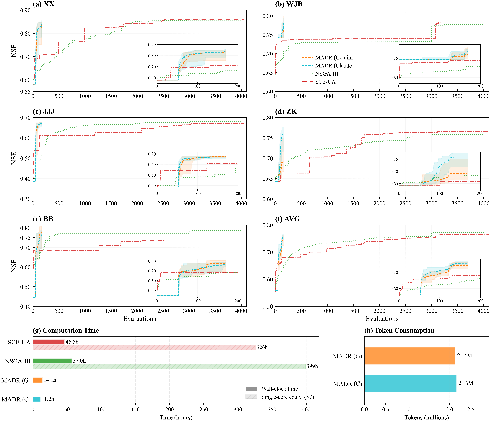

# MADR — Multi-Agent Diagnostic Reasoning for Distributed Hydrological Model Calibration

MADR is an LLM-driven framework that calibrates distributed hydrological models in nested-basin systems. A **Leader Agent** synthesizes cross-station simulation errors into structured per-basin guidance; **Worker Agents** translate that guidance into concrete parameter sets. The framework is implemented in [LangGraph](https://github.com/langchain-ai/langgraph), runs through any major LLM provider's native SDK, and treats both the hydrological model and the LLM as pluggable components — three model combinations and seven LLM providers ship today.

In the paper, MADR approaches the calibration accuracy of two benchmark optimization algorithms (SCE-UA, NSGA-III) at less than 5% of their evaluation budget across five nested gauging stations of the Huai River basin, and Worker-level LLM reasoning consistently outperforms a deterministic rule-based executor across both Gemini and Claude.

📦 **Preprint**: Zhao, Li, Zhu, Jin, Zhang (2026). *LLM-Driven Diagnostic Reasoning for Distributed Hydrological Model Calibration*. Research Square. [10.21203/rs.3.rs-10106384/v1](https://doi.org/10.21203/rs.3.rs-10106384/v1)
📂 **Dataset**: observations, model inputs, all calibration runs, and benchmark outputs on Zenodo. [10.5281/zenodo.20622937](https://doi.org/10.5281/zenodo.20622937)

## Repository contents

| Folder | Purpose |
|---|---|
| **`MADR/`** | The framework. Three hydrological-model combinations and seven LLM providers, all behind a single LangGraph workflow. |
| **`SADR/`** | Single-Agent Diagnostic Reasoning ablation control — the Leader is retained, but the LLM-based Worker is replaced by a deterministic rule-based executor. Scope: VIC + Lohmann routing only. |
| **`routing/`** | The Lohmann routing model Fortran source with this study's local modifications and a Makefile. Build with `cd routing && make`. |

---

## What the framework does

Three characteristics define MADR:

1. **Three sources of knowledge** are combined at every round — the LLM's pretrained domain knowledge, expert knowledge supplied via prompts and a diagnostic-rules table, and iterative understanding built from per-round simulation feedback.
2. **Dynamic information exchange** runs among the agents both within a round (downstream Workers see upstream Workers' fresh proposals) and across rounds (the Leader's per-basin guidance evolves with the search trajectory).
3. **Phased decomposition** splits calibration into sequential stages over tractable parameter subspaces, so each round of LLM reasoning operates at a lower effective dimensionality.

### Leader / Worker division

Global guidance and per-basin parameter proposals both draw on pretrained knowledge, expert rules, and per-round feedback, but the two reasoning tasks emphasize different aspects. MADR therefore separates them into two coordinated roles:

- **Leader Agent** — global-view agent. Activated once at the end of each round, it integrates the per-basin diagnostic results into a system-wide evaluation, reasons over the upstream–downstream topology, and outputs per-basin direction-and-magnitude guidance for the next round. The Leader does **not** produce parameter values directly.
- **Worker Agents** — N local-view agents, one per sub-basin. Each Worker is activated at the start of each round to translate the Leader's guidance for its basin into a concrete parameter proposal, using its own performance history and diagnostic signals as additional context.

```
                                    ┌─→ Worker 1            ─→ Model run
                                    ├─→ Worker 2            ─→ Model run
Leader (per-round global diagnosis) ┼─→ Worker 3            ─→ Model run
                                    ├─→ ...                 ─→ Model run
                                    └─→ Worker N (outlet)   ─→ Model run
```

A complete round proceeds through four steps:

1. **Worker activation** — Workers are invoked in topological order, headwater first, using the Leader's guidance from the previous round.
2. **Simulation** — Proposed parameters drive the model combination selected for the run.
3. **Evaluation** — Simulated streamflow is scored with overall objectives, statistical metrics (NSE, KGE, PBIAS, RMSE), and process signatures (peak ratio, peak timing bias, recession K ratio, etc.).
4. **Leader review** — The Leader produces guidance for the next round.

Three coordination mechanisms keep the Workers consistent: **topological processing** (Workers partitioned into upstream→downstream levels via Kahn's algorithm), **information exchange** (upstream Workers' fresh parameters get written into the downstream sub-basin's model state before the downstream run), and **parameter locking** (once an upstream Worker has proposed for a round, those values are immutable for the rest of that round).

---

## Calibration strategy

MADR runs an **Exploration Stage** followed by one or more **sequential Agent Phases**. The number and content of phases are defined by the model combination — each combination ships its own phase pipeline, chosen so that successive phases isolate a tractable parameter subspace. Every phase ends as soon as either of two conditions fires:

1. **Patience-based early termination** (recommended) — the in-phase mean sub-basin NSE has not improved for `patience_rounds` consecutive **single-candidate** rounds. Multi-candidate rounds are excluded from the counter so aggressive exploration does not trip the trigger.
2. **`max_rounds` cap** — a hard upper bound that always applies, providing a safety ceiling on per-phase cost.

This adaptive behavior is the headline of the current build: each phase stops as soon as it plateaus, rather than always running to its full round budget.

- **Exploration Stage** (before any Agent Rounds): a configurable number of simulations per sub-basin, drawn as a mix of Gaussian perturbations around the configured default and Latin Hypercube samples across the feasible range. The per-sub-basin summary (best NSE, top NSE values, best parameter combination) is injected into every Worker's prompt as fixed contextual reference and shown to the Leader once at Round 1. The exploration is **soft contextual evidence** to the LLMs; it does not modify the initial parameter center or the search radius.
- **Multi-candidate generation** (early rounds of selected phases): every Worker is invoked three times with strategy tags `conservative` / `moderate` / `bold`; the candidate with the highest NSE is adopted as that round's proposal.
- **Round 1 special case**: the Worker LLM is not invoked. The model runs with the configured default parameters, providing the baseline against which the Leader's first guidance is issued.
- **Final round (force-best)**: after the last phase ends — whether by patience or by `max_rounds` — MADR runs one mandatory final round in which each Worker uses its own per-sub-basin best historical parameters, delivering a clean end-state composite.

A phase entry in the pipeline looks like this (generic shape — see the Case Study below for a concrete instantiation):

```jsonc
{"name": "PHASE_NAME", "max_rounds": M, "mc_rounds": K, "mc_candidates": 3, "patience_rounds": P}
```

`mc_rounds` says how many of the first K rounds of that phase use the multi-candidate mechanism; `patience_rounds` is optional (omit, or set to `999`, to disable early termination and force the full `max_rounds`).

---

## Pluggable model and LLM components

MADR keeps the hydrological model and the LLM provider behind narrow, swappable interfaces. The static knowledge (parameter sensitivity, domain knowledge, diagnostic rules, basin topology) flows into both the Worker LLM and the Leader LLM each round; the dynamic diagnostic information (round history, search center, phase state) feeds them in parallel. The "Worker LLM" and "Leader LLM" sockets accept any of the supported providers, and the "Model run" block accepts any of the supported model combinations.



### Hydrological model combinations

| Combination | Land surface | Routing | Phases | Tunable parameters |
|---|---|---|---|---|
| `vic_routing` (paper default) | [VIC 5.1](https://github.com/UW-Hydro/VIC) | Lohmann (Fortran source in [`routing/`](routing/)) | `VIC_ONLY → ROUTING_ONLY → JOINT` | 6 soil + 2 routing = 8 |
| `vic_cama_flood` | [VIC 5.1](https://github.com/UW-Hydro/VIC) | [CaMa-Flood v4.20](https://github.com/global-hydrodynamics/CaMa-Flood_v4) | `VIC_ONLY → CAMA_FLOOD_ONLY → JOINT` | 6 soil + 4 channel = 10 |
| `swat` | [SWAT+](https://swatplus.gitbook.io/docs) (integrated land + routing) | (built-in) | `SWATPLUS_HRU` | 18 (HRU + groundwater + snow) |

Adding a new combination is a four-step recipe: drop in `MADR/prompts/<combination>/` (six prompt files), implement `MADR/scripts/executors/<combination>.py` as a `ModelExecutor` subclass, register it in the factory at `MADR/scripts/executors/__init__.py`, and add a sample config under `MADR/configs/`. See `MADR/docs/architecture.md` for the design rationale.

### LLM providers

All providers below are supported out of the box by `MADR/scripts/llm_client.py`. Switching is a config-only change — modify `model`, `provider`, and `api_key_env` in the config, then set the corresponding environment variable. Provider-specific quirks (GPT-5.x / o-series `max_completion_tokens`, Kimi K2.6 temperature constraints, Kimi/Qwen proxy bypass) are handled automatically.

| Provider | Example model | API key env var | `timeout_sec` | SDK |
|---|---|---|---|---|
| **Claude** (Anthropic, default) | `claude-sonnet-4-6` | `ANTHROPIC_API_KEY` | 240 | `pip install anthropic` |
| **Gemini** (Google) | `gemini-2.5-flash` (or `gemini-3-flash-preview`) | `GEMINI_API_KEY` | 240 | `pip install google-genai` |
| **OpenAI** | `gpt-5.4` / `gpt-5.4-mini` | `OPENAI_API_KEY` | 240 | `pip install openai` |
| **DeepSeek** | `deepseek-v4-pro` / `deepseek-v4-flash` | `DEEPSEEK_API_KEY` | 240 | `pip install openai` |
| **Kimi** (Moonshot) | `kimi-k2.6` | `KIMI_API_KEY` | **300** | `pip install openai httpx` |
| **Qwen** (DashScope) | `qwen3-max` | `DASHSCOPE_API_KEY` | 240 | `pip install openai` |
| **MiniMax** | `MiniMax-M2.5` | `MINIMAX_API_KEY` | 240 | `pip install anthropic` |

Example — switch from Claude to Gemini in any config:

```jsonc
"leader": {
  "model": "gemini-2.5-flash",
  "provider": "gemini",
  "api_key_env": "GEMINI_API_KEY",
  "temperature": 0.3, "max_tokens": 8192, "timeout_sec": 240.0
}
```

For multi-agent (MADR) runs, repeat the same swap in every `workers[]` entry. For SADR (Leader-only ablation), only the `leader` block changes.

---

## Case study: VIC + Lohmann on the Huai River basin

The paper validates MADR on the catchment upstream of the Bengbu gauging station in the Huai River basin (121,330 km²), with **five nested control stations**: Xixian (XX) → Wangjiaba (WJB) → Bengbu (BB) on the main stem, with Zhoukou (ZK) and Jiangjiaji (JJJ) on tributaries entering between WJB and BB. The example config `MADR/configs/vic_routing_bengbu.json` reproduces this setup.

**Run summary:**

- **Calibration period**: 1981–1990 (1980 spin-up)
- **Validation period**: 1991–1996 (independent transferability test)
- **Per-basin budget**: 170 model evaluations (50 Exploration + 120 Agent Rounds)
- **LLMs tested**: Claude Sonnet 4.6, Gemini 3 Flash Preview

**Recommended phase pipeline** for this case (patience enabled):

```jsonc
"phase_config": {
  "pipeline": [
    {"name": "VIC_ONLY",     "max_rounds": 50, "mc_rounds": 11, "mc_candidates": 3, "patience_rounds": 10},
    {"name": "ROUTING_ONLY", "max_rounds": 30, "mc_rounds":  5, "mc_candidates": 3, "patience_rounds":  5},
    {"name": "JOINT",        "max_rounds": 10, "mc_rounds":  0, "mc_candidates": 0, "patience_rounds":  3}
  ]
}
```

With patience enabled, this typically converges in ~110–150 evaluations per sub-basin. **To reproduce the paper's fixed-budget runs exactly**, omit `patience_rounds` (or set it to `999`); each phase then runs to its full `max_rounds`, giving exactly 170 evaluations per sub-basin (50 Exploration + 75 single-candidate × 1 + 15 multi-candidate × 3).

### Results



Within its 170-evaluation budget, MADR (Gemini 0.744, Claude 0.760 basin-average NSE) approaches the accuracy that SCE-UA (0.764) and NSGA-III (0.772) achieve only after their full 4,000-evaluation budget — about 23–36× less single-core wall-clock time at ~2.15 M tokens per run. Table 6 shows how many evaluations the conventional algorithms need at the station level to match MADR's final NSE; "—" indicates the threshold was never reached within the 4,000-evaluation budget.

**Table 6.** Number of evaluations the conventional algorithms need to reach MADR's best NSE.

| LLM Source | Algorithm | XX | WJB | JJJ | ZK | BB |
|---|---|---:|---:|---:|---:|---:|
| Gemini | NSGA-III | 1808 | 3004 | 2039 | 252 | 3004 |
| Gemini | SCE-UA | 1745 | 3081 | — | 658 | — |
| Claude | NSGA-III | 1808 | — | 1950 | 3051 | 475 |
| Claude | SCE-UA | 1745 | 3165 | 3037 | 2069 | — |

The full dataset (observations + VIC/Lohmann inputs + 10 × MADR runs × 2 LLMs + SCE-UA and NSGA-III outputs) is in the Zenodo record above.

---

## Quick Start

### Prerequisites

- Python 3.10+
- The compiled binary for whichever combination you intend to use:
  - **VIC + Lohmann**: [VIC 5.1](https://github.com/UW-Hydro/VIC) executable + the Lohmann routing executable from [`routing/`](routing/) (build with `make`)
  - **VIC + CaMa-Flood**: VIC 5.1 + [CaMa-Flood v4.20](https://github.com/global-hydrodynamics/CaMa-Flood_v4) `MAIN_cmf`
  - **SWAT+**: a compiled [SWAT+](https://swatplus.gitbook.io/docs) executable
- Forcing, soil, vegetation, and routing input files (the paper's are in the Zenodo dataset)

### Install Python dependencies

```bash
pip install langgraph anthropic
# Add the SDKs for any other LLM providers you intend to use:
# pip install google-genai           # Gemini
# pip install openai httpx           # OpenAI / DeepSeek / Kimi
```

### Set your LLM API key

```bash
export ANTHROPIC_API_KEY="your-key"    # default in the shipped configs
# or any of: GEMINI_API_KEY, OPENAI_API_KEY, DEEPSEEK_API_KEY, KIMI_API_KEY, ...
```

### Replace local paths in the config

The shipped configs contain the original author's absolute paths to executables and data. **Replace them before running.** Every config has a top-level `_path_replacement_notice` field flagging which fields need editing.

### Run

```bash
cd MADR

# VIC + Lohmann (paper default)
python -m scripts.run_langgraph \
    --team-config configs/vic_routing_bengbu.json \
    --output-root ./output

# VIC + CaMa-Flood
python -m scripts.run_langgraph \
    --team-config configs/vic_cama_flood_songhua.json \
    --output-root ./output

# SWAT+
python -m scripts.run_langgraph \
    --team-config configs/swat_yellow.json \
    --output-root ./output
```

CLI options: `--team-config PATH`, `--output-root PATH`, `--result-repo PATH`, `--run-name NAME`, `--resume`, `--dry-run`, `--max-rounds N`, `--log-level LEVEL`, `--thread-id ID`.

---

## Configuration

The `MADR/configs/` folder ships four examples:

| File | Combination | Purpose |
|---|---|---|
| `_template.json` | (any) | Annotated master template — every field documented inline via `_doc_*` keys |
| `vic_routing_bengbu.json` | `vic_routing` | Paper's Huai River 5-basin setup (Bengbu outlet) |
| `vic_cama_flood_songhua.json` | `vic_cama_flood` | Songhua River nested pair (Jiangqiao → Jiamusi), real-mode CaMa-Flood pipeline |
| `swat_yellow.json` | `swat` | Yellow River Tangnaihai → Lanzhou, single-phase SWATPLUS_HRU calibration |

---

## SADR — the ablation control

The sibling `SADR/` folder contains the Single-Agent Diagnostic Reasoning ablation used in the paper. The Leader is identical to MADR's, but the LLM-based Worker is replaced by a deterministic rule-based code executor — the Worker reads the Leader's (direction, magnitude) guidance, maps it through a fixed lookup table into a step around the historical best, and applies a step-decay schedule plus a three-tier escape protocol when a sub-basin stagnates. The LangGraph workflow above shows the SADR-specific nodes in red.

- **Scope**: VIC + Lohmann routing only. SADR is not extended to other model combinations.
- **Purpose**: ablation control that isolates the contribution of the LLM-based Worker. For real applications, use MADR — Worker-level LLM reasoning consistently outperforms the rule-based executor across both Gemini and Claude.
- **Budget**: identical to MADR (170 evaluations per sub-basin) for an apples-to-apples comparison.

---

## Roadmap

The pluggable-executor architecture is built for incremental growth. Future work will verify and integrate **additional distributed hydrological models** as new combinations under the same framework, so the same Leader–Worker workflow can drive calibrations of land-surface, channel-routing, and coupled hydrological systems beyond the three combinations shipped today.

More broadly, the multi-agent diagnostic-reasoning pattern is well suited to other multi-objective optimization problems in the Earth and water sciences — reservoir operation, water-resource allocation, and broader Earth-system calibration tasks are natural next targets where the same Leader–Worker structure could replace scalar-objective optimization with diagnostic-signal-aware reasoning.

---

## Citation

If you use this code, please cite the preprint:

> Yichen Zhao, Ziwei Li, Liujun Zhu, Junliang Jin, Jianyun Zhang. *LLM-Driven Diagnostic Reasoning for Distributed Hydrological Model Calibration*. Research Square, Preprint (Version 1), 22 June 2026. https://doi.org/10.21203/rs.3.rs-10106384/v1

### Companion dataset

> Zhao, Y. (2026). Dataset for "LLM-Driven Diagnostic Reasoning for Distributed Hydrological Model Calibration". Zenodo. https://doi.org/10.5281/zenodo.20622937

---

## License

The MADR framework (this repository, excluding `routing/`) is released under the **MIT License** — see [LICENSE](LICENSE).

The Fortran code in [`routing/`](routing/) is the Lohmann routing model originally distributed by the University of Washington VIC group. It has circulated freely in the research community for many years without a formal license; we include it here with the local modifications documented in [`routing/README.md`](routing/README.md) so the calibration experiments are end-to-end reproducible. Treat that subtree as governed by its upstream provenance, not by the repository-level MIT license.
