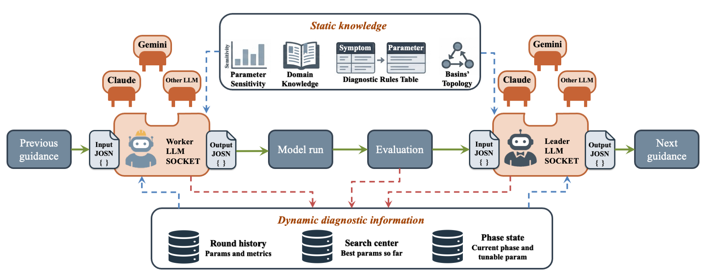
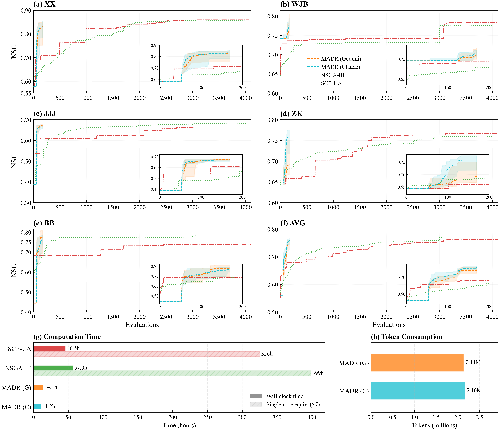

# MADR — 面向分布式水文模型率定的多智能体诊断推理框架
（Multi-Agent Diagnostic Reasoning for Distributed Hydrological Model Calibration）

MADR 是一个由大语言模型（LLM）驱动的框架，用于在嵌套流域系统中率定分布式水文模型。**主控智能体（Leader Agent）** 将跨站点的模拟误差综合为结构化的分流域指导；**执行智能体（Worker Agents）** 将该指导转化为具体的参数组合。框架基于 [LangGraph](https://github.com/langchain-ai/langgraph) 实现，并将水文模型与 LLM 均视为可插拔组件。内置**四种**水文模型组合以及若干已测试的 LLM 适配器，且均可通过 **API 与本地 CLI 两种方式**使用。

在论文中，MADR 在淮河流域五个嵌套水文站上，以不足两种基准优化算法（SCE-UA、NSGA-III）5% 的评估预算，逼近了它们的率定精度；并且在 Gemini 与 Claude 上，Worker 层的 LLM 推理均稳定优于确定性的规则执行器。

📦 **预印本**：Zhao, Li, Zhu, Jin, Zhang (2026). *LLM-Driven Diagnostic Reasoning for Distributed Hydrological Model Calibration*. Research Square. [10.21203/rs.3.rs-10106384/v1](https://doi.org/10.21203/rs.3.rs-10106384/v1)
📂 **数据集**：观测数据、模型输入、全部率定运行结果与基准输出，见 Zenodo。[10.5281/zenodo.20622937](https://doi.org/10.5281/zenodo.20622937)

> **版本说明。** 与 Version 1 预印本对应的首个公开代码发布保存在标签 [`v0.1.0`](https://github.com/jovequli/MADR/tree/v0.1.0)。[`v0.2.0`](https://github.com/jovequli/MADR/tree/v0.2.0) 引入了首次正确性与稳健性更新。[`v0.2.1`](https://github.com/jovequli/MADR/tree/v0.2.1) 同步了公开运行说明、正式示例流程、依赖安装与轮次预算语义。**v0.3.0**（本集成构建）新增第四个水文模型（wflow）、无需 API 密钥的 CLI 接入方式，以及可复现性支持层 —— 详见下方更新章节。

---

## 🆕 更新 — v0.3.0 版本（集成构建）

本次发布将此前各自独立、已单独验证的模块整合为单一集成构建，新增了第四个水文模型，并加入了可复现性支持层。Lohmann `routing/` 模型与 `SADR/` 消融对照相较上一版本保持不变。

**新增**

- **WFlow（`wflow_sbm`）模型组合** — 由同一套 Leader–Worker 工作流驱动的第四个模型（集成陆面过程 + 运动波汇流；8 个可调参数，含融雪）。详见下方模型表。
- **CLI 接入，无需 API 密钥** — Worker/Leader 的 LLM 接口现在除 API 适配器外，还接受本地 CLI 提供方（`claude_cli`、`codex_cli`），因此整个率定过程可完全通过已安装的 CLI 命令驱动，无需设置任何 API 密钥。框架不绑定任何模型版本：切换 LLM 只需更换一条 CLI 命令或一个 API 密钥。
- **可复现性与运行管理** — 每次运行都会写入溯源快照（精确配置、提示词树、代码版本、运行环境）、逐字的 LLM 调用日志（`llm_calls.jsonl`）以及收敛曲线图；分级归档器会按“可再生性”对已完成的运行进行压缩与裁剪。详见下方新增章节。
- **跨组合一致性** — 单一共享的径流指标模块（所有组合的 NSE/KGE/PBIAS 及过程特征完全一致）；VIC 支持月尺度观测与显式评估窗口；SWAT+ 采用对象类型参数路由（`hru`/`sol`/`aqu`/`bsn`/`rte`），含 HRU→含水层映射与文献对齐的参数集。

**修复**

- **每个候选的诊断信息现在会在每一轮迭代中保存。** 在多候选轮次中，每个候选的诊断推理会分别写入各自的 `worker_<basin>_c<k>_<strategy>_diagnostic.json`，迭代过程中不再丢失诊断信息。
- **现已支持 CLI 使用方式。** Claude/Codex 可通过本地 CLI 驱动，无需 `ANTHROPIC_API_KEY`。

---

## 仓库内容

| 目录 | 用途 |
|---|---|
| **`MADR/`** | 框架本体。四种水文模型组合与已测试的 LLM 适配器（API 与 CLI），统一在单一 LangGraph 工作流之后。 |
| **`SADR/`** | 单智能体诊断推理（Single-Agent Diagnostic Reasoning）消融对照 —— 保留 Leader，但用确定性的规则执行器替换基于 LLM 的 Worker。范围：仅 VIC + Lohmann 汇流。 |
| **`routing/`** | Lohmann 汇流模型的 Fortran 源码，含本研究的本地修改与 Makefile。编译：`cd routing && make`。 |

---

## 框架功能

MADR 具有三大特征：

1. **每一轮融合三类知识** —— LLM 预训练的领域知识、通过提示词与诊断规则表提供的专家知识，以及从逐轮模拟反馈中构建的迭代理解。
2. **智能体间的动态信息交换** —— 既在一轮之内（下游 Worker 可见上游 Worker 的最新提案），也跨轮进行（Leader 的分流域指导随搜索轨迹演化）。
3. **分阶段解耦** —— 将率定拆分为若干顺序阶段，每个阶段在可处理的参数子空间上进行，从而使每一轮 LLM 推理都在更低的有效维度上运行。

### 主控 / 执行 分工

全局指导与分流域参数提案都依赖预训练知识、专家规则与逐轮反馈，但两类推理任务侧重点不同。MADR 因此将其拆分为两个协同的角色：

- **主控智能体（Leader Agent）** —— 全局视角。每轮结束时激活一次，将各分流域的诊断结果整合为系统级评估，围绕上下游拓扑进行推理，并为下一轮输出各分流域的“方向 + 幅度”指导。Leader **不**直接产生参数值。
- **执行智能体（Worker Agents）** —— N 个局部视角智能体，每个子流域一个。每轮开始时激活，将 Leader 对本流域的指导，结合自身的历史表现与诊断信号，转化为一个具体的参数提案。

```
                                    ┌─→ Worker 1            ─→ 模型运行
                                    ├─→ Worker 2            ─→ 模型运行
Leader（每轮全局诊断）              ┼─→ Worker 3            ─→ 模型运行
                                    ├─→ ...                 ─→ 模型运行
                                    └─→ Worker N（出口站）  ─→ 模型运行
```

完整的一轮包含四个步骤：

1. **Worker 激活** —— 按拓扑顺序（源头优先）调用 Worker，使用上一轮 Leader 的指导。
2. **模拟** —— 提出的参数驱动所选的模型组合运行。
3. **评估** —— 用总体目标、统计指标（NSE、KGE、PBIAS、RMSE）与过程特征（峰值比、峰现时间偏差、退水系数比等）对模拟径流打分。
4. **Leader 复盘** —— Leader 产生下一轮的指导。

三种协调机制保证 Worker 之间的一致性：**拓扑处理**（用 Kahn 算法将 Worker 划分为上游→下游层级）、**信息交换**（在下游运行前，将上游 Worker 的最新参数写入下游子流域的模型状态）、以及**参数锁定**（某个上游 Worker 在本轮提案后，其取值在本轮剩余过程中不可更改）。

---

## 率定策略

MADR 可运行一个可选的**探索阶段（Exploration Stage）**，随后进行一个或多个**顺序的智能体阶段（Agent Phases）**。阶段的数量与内容由模型组合决定 —— 每种组合自带其阶段流水线，使相邻阶段隔离出一个可处理的参数子空间。每个阶段一旦满足以下任一条件即结束：

1. **基于耐心的提前终止**（推荐）—— 基于 VIC 的组合跟踪阶段内的平均子流域 NSE；SWAT+ 跟踪对所配置的流域级联合目标的接受情况。多候选轮次不计入该计数器，以免激进探索误触发。
2. **`max_rounds` 上限** —— 始终生效的硬上限，为单阶段成本设置安全天花板。

当配置了有限的耐心值时，阶段一旦收敛平台化即停止，而不必总是耗尽整个轮次预算。若需固定预算，将 `patience_rounds` 设为 `999`。

- **探索阶段**（可选，在任何智能体轮次之前）：对于基于 VIC 的组合，每个子流域抽取若干次模拟，混合了围绕配置默认值的高斯扰动与在可行域上的拉丁超立方（LHS）采样。随附的淮河配置使用 10 个近中心 + 40 个 LHS 样本。分流域摘要（最佳 NSE、若干高 NSE 取值、最优参数组合）作为固定上下文注入每个 Worker 的提示词，并在第 1 轮向 Leader 展示一次。探索为**软性上下文证据**，不修改初始参数中心或搜索半径。SWAT+ 示例默认禁用该 VIC 土壤探索器。
- **多候选生成**（选定阶段的前若干轮）：每个 Worker 以 `conservative`（保守）/ `moderate`（适中）/ `bold`（激进）等策略标签被调用。基于 VIC 的组合按 NSE 局部选择；SWAT+ 在一次流域级运行中评估每个策略，并按配置以 `mean_nse` 或 `j_total` 采纳一个共同的策略索引。
- **第 1 轮特例**：不调用 Worker LLM。模型以配置的默认参数运行，作为 Leader 首次指导的基线。
- **最终轮（force-best）**：优化流水线结束后，额外进行一轮验证 —— 基于 VIC 的组合恢复各流域的历史最优参数；SWAT+ 恢复一个已被接受的流域级联合参数包，从而绝不混用来自不同未经验证联合运行的参数。该最终运行不计入所配置的优化轮次预算。

优化全程同时保留 J_total 与 NSE。J_total 结合了流域平均 NSE 与峰值、低流一致性，而站点级与流域平均 NSE 仍是主要报告的性能指标。

流水线中的一个阶段条目形如（通用结构，具体实例见下方案例研究）：

```jsonc
{"name": "PHASE_NAME", "max_rounds": M, "mc_rounds": K, "mc_candidates": 3, "patience_rounds": P}
```

`mc_rounds=K` 在该阶段前 K 轮开启一个多候选窗口。全局第 1 轮始终为单候选（此时尚无 Leader 指导），因此第一个阶段中 `mc_rounds=11` 表示第 1 轮用默认值、第 2–11 轮为多候选。在后续阶段，前 K 轮全部使用多候选。`patience_rounds` 为可选（省略或设为 `999` 可禁用提前终止、强制跑满该阶段预算）。

顶层 `max_rounds` 是对**优化轮次**的可选上限，不含额外的最终验证轮。取值 `0` 时由各阶段 `max_rounds` 之和推导；取正值则覆盖该和。CLI 的 `--max-rounds` 选项优先级最高，且采用相同的“仅优化轮”语义。

---

## 可插拔的模型与 LLM 组件

MADR 将水文模型与 LLM 提供方置于狭窄、可替换的接口之后。静态知识（参数敏感性、领域知识、诊断规则、流域拓扑）每轮流入 Worker LLM 与 Leader LLM；动态诊断信息（轮次历史、搜索中心、阶段状态）并行地馈入两者。“Worker LLM”与“Leader LLM”两个插槽接受任一受支持的提供方，“模型运行”模块接受任一受支持的模型组合。



### 水文模型组合

| 组合 | 陆面 | 汇流 | 阶段 | 可调参数 |
|---|---|---|---|---|
| `vic_routing`（论文默认） | [VIC 5.1](https://github.com/UW-Hydro/VIC) | Lohmann（Fortran 源码见 [`routing/`](routing/)） | `VIC_ONLY → ROUTING_ONLY → JOINT` | 6 土壤 + 2 汇流 = 8 |
| `vic_cama_flood` | [VIC 5.1](https://github.com/UW-Hydro/VIC) | [CaMa-Flood v4.20](https://github.com/global-hydrodynamics/CaMa-Flood_v4) | `VIC_ONLY → CAMA_FLOOD_ONLY → JOINT` | 6 土壤 + 4 河道 = 10 |
| `swat` | [SWAT+](https://swatplus.gitbook.io/docs)（集成陆面 + 汇流） | （内置） | `SWATPLUS_HRU` | 24（HRU + 土壤 + 含水层 + 流域 + 河道 + 融雪） |
| `wflow` | [wflow_sbm](https://github.com/Deltares/Wflow.jl)（集成陆面 + 运动波汇流） | （内置） | `WFLOW_SBM` | 8（土壤/汇流 + 融雪：KsatHorFrac、KsatVer、f、SoilThickness、N、N_River、TT、Cfmax） |

新增一个组合是四步流程：放入 `MADR/prompts/<combination>/`（六个提示词文件），将 `MADR/scripts/executors/<combination>.py` 实现为 `ModelExecutor` 子类，在工厂 `MADR/scripts/executors/__init__.py` 中注册，并在 `MADR/configs/` 下添加一个示例配置。设计理念见 `MADR/docs/architecture.md`。

### LLM 适配器（API 与 CLI）

下表为已测试的示例提供方，并非详尽的兼容性列表。在已含适配器之间切换仅需改配置：修改 `model`、`provider`、`api_key_env`，并设置相应环境变量。其他可通过 API 访问的模型 —— 包括 GLM 系列服务以及更多 OpenAI 或 Anthropic 兼容端点 —— 均可通过配置或一个轻量传输适配器接入。扩展 LLM 层主要是 API 集成工作；而新增一个水文模型则需要新的执行器、参数语义、模型专属的诊断知识以及独立的物理验证。

| 提供方 | 示例模型 | API 密钥环境变量 | `timeout_sec` | SDK |
|---|---|---|---|---|
| **Claude**（Anthropic，默认） | `claude-sonnet-4-6` | `ANTHROPIC_API_KEY` | 240 | `pip install anthropic` |
| **Gemini**（Google） | `gemini-2.5-flash`（或 `gemini-3-flash-preview`） | `GEMINI_API_KEY` | 240 | `pip install google-genai` |
| **OpenAI** | `gpt-5.4` / `gpt-5.4-mini` | `OPENAI_API_KEY` | 240 | `pip install openai` |
| **DeepSeek** | `deepseek-v4-pro` / `deepseek-v4-flash` | `DEEPSEEK_API_KEY` | 240 | `pip install openai` |
| **Kimi**（Moonshot） | `kimi-k2.6` | `KIMI_API_KEY` | **300** | `pip install openai httpx` |
| **Qwen**（DashScope） | `qwen3-max` | `DASHSCOPE_API_KEY` | 240 | `pip install openai` |
| **MiniMax** | `MiniMax-M2.5` | `MINIMAX_API_KEY` | 240 | `pip install anthropic` |

示例 —— 在任意配置中从 Claude 切换到 Gemini：

```jsonc
"leader": {
  "model": "gemini-2.5-flash",
  "provider": "gemini",
  "api_key_env": "GEMINI_API_KEY",
  "temperature": 0.3, "max_tokens": 8192, "timeout_sec": 240.0
}
```

对于多智能体（MADR）运行，在每个 `workers[]` 条目中重复相同替换；对于 SADR（仅 Leader 的消融），只需改 `leader` 块。

**CLI 适配器（无需 API 密钥）。** 除上述 API 适配器外，同一 LLM 插槽还接受本地 CLI 提供方：`"provider": "claude_cli"` 驱动已安装的 `claude` 命令（Claude Code CLI，通过其自身登录鉴权 —— 无需 `ANTHROPIC_API_KEY`），`"provider": "codex_cli"` 驱动 `codex` 命令。由于其本质只是“调用一个本地 CLI 可执行文件”，同样的免密钥方式适用于任何提供 CLI 的提供方 —— 包括 **Kimi** 与 **Qwen（千问）** —— 只需将 provider 指向相应命令即可。当你持有 CLI 订阅而非 API 密钥时，推荐此路径。由于底层模型取决于该 CLI 登录的账号，这里切换 LLM 仅是换用哪个 CLI 的问题。

> 上表列出的示例模型只是某一时点的示意。各提供方频繁发布新模型，请将 `model` 设为你当前可访问的模型（或通过 CLI 选择）。MADR 不依赖任何特定模型版本。

---

## 可复现性与运行管理

每次运行都会在其输出目录中写入用于复现与审计所需的产物：

- **`provenance/`** —— 启动时的一次性快照：实际加载的配置（内容，而非仅路径）加 `argv`、完整的提示词模板树、代码版本（git commit + clean/dirty，非 git 环境记为 `unknown`），以及 Python/平台/主机/关键包的环境信息。
- **`llm_calls.jsonl`** —— 逐字、先写后解析的每次 LLM 调用日志（system + messages、原始回复、finish reason、token 用量、耗时、调用者身份），含截断重试与失败尝试。由 `MADR_LLM_LOG` 控制，自动设为 `<output_root>/llm_calls.jsonl`；不设置该变量即禁用。
- **`convergence.png`** —— 每次运行的收敛曲线图（横轴 Round、纵轴各站 NSE，含被拒绝的多候选点），仅从 A 层文件渲染，因此对已归档的运行同样可用。
- **分级归档器** —— `python -m scripts.archive_run --run-dir <run>`（默认仅演练，加 `--apply` 执行）：压缩日尺度汇流输出，删除可再生的工作目录与缓存，并对检查点数据库执行 VACUUM，同时保留不可再生的证据，并生成 `SHA256SUMS` 与 `RETENTION.md`。

以上任何一项都不会阻塞或改变率定运行；任何失败都仅降级为告警。

---

## 案例研究：淮河流域 VIC + Lohmann

论文在淮河流域蚌埠水文站以上流域（121,330 km²）验证 MADR，含**五个嵌套控制站**：干流上的 息县（XX）→ 王家坝（WJB）→ 蚌埠（BB），以及在 WJB 与 BB 之间汇入的支流站 周口（ZK）与 蒋家集（JJJ）。示例配置 `MADR/configs/vic_routing_bengbu.json` 复现该设置。

**运行摘要：**

- **率定期**：1981–1990（1980 预热）
- **验证期**：1991–1996（独立的可迁移性检验）
- **论文评估预算**：每个流域 170 次模型评估
- **测试的 LLM**：Claude Sonnet 4.6、Gemini 3 Flash Preview

随附配置仅运行率定期。论文的 1991–1996 验证是使用率定参数集的独立固定参数评估，不会由快速开始命令自动启动。

该案例的**推荐阶段流水线**（启用耐心）：

```jsonc
"phase_config": {
  "pipeline": [
    {"name": "VIC_ONLY",     "max_rounds": 50, "mc_rounds": 11, "mc_candidates": 3, "patience_rounds": 10},
    {"name": "ROUTING_ONLY", "max_rounds": 30, "mc_rounds":  5, "mc_candidates": 3, "patience_rounds":  5},
    {"name": "JOINT",        "max_rounds": 10, "mc_rounds":  0, "mc_candidates": 0, "patience_rounds":  3}
  ]
}
```

该流水线共 90 个优化轮。第 1 轮为默认基线；`VIC_ONLY` 的第 2–11 轮与 `ROUTING_ONLY` 的前五轮使用三个候选，即 75 个单候选优化轮与 15 个三候选轮。加上 50 次探索模拟以及当前构建额外的最终验证，每个流域最多 171 次模型执行；耐心通常会降低该总数。下文报告的 170 次评估结果，是随 Version 1 预印本归档的固定预算实验；维护版代码将最终验证显式地作为“额外”一轮，而非悄悄占用最后一个优化槽。

### 结果



在 170 次评估预算内，MADR（Gemini 流域平均 NSE 0.744，Claude 0.760）逼近了 SCE-UA（0.764）与 NSGA-III（0.772）在其全部 4000 次评估预算后才达到的精度 —— 单核墙钟时间约减少 23–36 倍，每次运行约 2.15 M token。表 6 展示了传统算法在站点层面需要多少次评估才能匹配 MADR 的最终 NSE；“—”表示在 4000 次评估预算内从未达到该阈值。

**表 6.** 传统算法达到 MADR 最佳 NSE 所需的评估次数。

| LLM 来源 | 算法 | XX | WJB | JJJ | ZK | BB |
|---|---|---:|---:|---:|---:|---:|
| Gemini | NSGA-III | 1808 | 3004 | 2039 | 252 | 3004 |
| Gemini | SCE-UA | 1745 | 3081 | — | 658 | — |
| Claude | NSGA-III | 1808 | — | 1950 | 3051 | 475 |
| Claude | SCE-UA | 1745 | 3165 | 3037 | 2069 | — |

完整数据集（观测 + VIC/Lohmann 输入 + 10 × MADR 运行 × 2 LLM + SCE-UA 与 NSGA-III 输出）见上方 Zenodo 记录。

---

## 快速开始

### 前置条件

- Python 3.10+
- 所用组合对应的已编译二进制：
  - **VIC + Lohmann**：[VIC 5.1](https://github.com/UW-Hydro/VIC) 可执行文件 + 来自 [`routing/`](routing/) 的 Lohmann 汇流可执行文件（`make` 编译）
  - **VIC + CaMa-Flood**：VIC 5.1 + [CaMa-Flood v4.20](https://github.com/global-hydrodynamics/CaMa-Flood_v4) `MAIN_cmf`
  - **SWAT+**：已编译的 [SWAT+](https://swatplus.gitbook.io/docs) 可执行文件
- 气象驱动、土壤、植被与汇流输入文件（论文所用见 Zenodo 数据集）

### 安装 Python 依赖

```bash
pip install -r requirements.txt
```

依赖文件包含 LangGraph 的 SQLite 检查点、NumPy、已测试的 LLM SDK，以及 CaMa-Flood 适配器所用的 pandas/netCDF4 依赖。

### 设置 LLM API 密钥

```bash
export ANTHROPIC_API_KEY="your-key"    # 随附配置的默认项
# 或：GEMINI_API_KEY、OPENAI_API_KEY、DEEPSEEK_API_KEY、KIMI_API_KEY、
#     DASHSCOPE_API_KEY 或 MINIMAX_API_KEY
```

或使用 **CLI 路径** —— 无需 API 密钥。将配置的 `provider` 设为 `claude_cli`（或 `codex_cli`），并确保相应 CLI（`claude` / `codex`）已安装并登录。

### 配置模型与数据路径

随附配置使用通用的 `/path/to/...` 占位符，运行前请替换为你自己的模型安装与数据集路径。对于 SWAT+，若工作 `TxtInOut` 目录中尚无 `cal_parms.cal`，需设置 `MADR_SWATPLUS_CAL_PARMS` 以便将其复制进去。

### 运行

```bash
cd MADR

# VIC + Lohmann（论文默认）
python -m scripts.run_langgraph \
    --team-config configs/vic_routing_bengbu.json \
    --output-root ./output/vic_routing_bengbu

# VIC + CaMa-Flood
python -m scripts.run_langgraph \
    --team-config configs/vic_cama_flood_songhua.json \
    --output-root ./output/vic_cama_flood_songhua

# SWAT+
python -m scripts.run_langgraph \
    --team-config configs/swat_yellow.json \
    --output-root ./output/swat_yellow

# WFlow（wflow_sbm）
python -m scripts.run_langgraph \
    --team-config configs/wflow_nested.json \
    --output-root ./output/wflow_nested
```

CLI 选项：`--team-config PATH`、`--output-root PATH`、`--result-repo PATH`、`--run-name NAME`、`--resume`、`--dry-run`、`--max-rounds N`、`--log-level LEVEL`、`--thread-id ID`。

- `--dry-run` 用确定性回退替换 Leader 与 Worker 的 API 调用；它**不**跳过水文可执行文件。若要在不运行 VIC、CaMa-Flood 或 SWAT+ 的情况下测试编排，请使用将 `model_binding.mode` 设为 `simulate` 的配置副本。
- `--resume` 必须使用与被中断运行相同的 `--output-root` 与 `--thread-id`，因为 SQLite 检查点存放在该输出目录内。
- 每个独立运行使用不同的输出目录。`--result-repo PATH --run-name NAME` 可自动创建带时间戳的运行文件夹；之后通过其确切文件夹路径以 `--output-root` 恢复。
- `--max-rounds N` 将优化限制为 N 轮，并仍保留额外的一轮 force-best 验证。

---

## 配置

`MADR/configs/` 文件夹随附示例：

| 文件 | 组合 | 用途 |
|---|---|---|
| `_template.json` | （任意） | 通用工作流字段的带注释模板，通过 `_doc_*` 键内联说明 |
| `vic_routing_bengbu.json` | `vic_routing` | 论文的淮河五流域设置（蚌埠出口） |
| `vic_cama_flood_songhua.json` | `vic_cama_flood` | 松花江嵌套站对（江桥 → 佳木斯），完整 real 模式 `VIC_ONLY → CAMA_FLOOD_ONLY → JOINT` 流水线 |
| `swat_yellow.json` | `swat` | 黄河 唐乃亥 → 兰州，real 模式 90 轮 `SWATPLUS_HRU` 流水线，采用流域级 J_total 选择 |
| `wflow_nested.json` | `wflow` | 嵌套 wflow_sbm 示例，`WFLOW_SBM` 流水线 |

---

## SADR — 消融对照

同级的 `SADR/` 文件夹包含论文所用的单智能体诊断推理（Single-Agent Diagnostic Reasoning）消融。其 Leader 与 MADR 完全相同，但基于 LLM 的 Worker 被替换为确定性的规则代码执行器 —— Worker 读取 Leader 的（方向、幅度）指导，经固定查找表映射为围绕历史最优的一步，并在某子流域停滞时应用步长衰减调度与三级逃逸协议。上文的 LangGraph 工作流图中，SADR 专属节点以红色标示。

- **范围**：仅 VIC + Lohmann 汇流。SADR 未扩展到其他模型组合。
- **目的**：作为消融对照，用以隔离基于 LLM 的 Worker 的贡献。实际应用请使用 MADR —— 在 Gemini 与 Claude 上，Worker 层的 LLM 推理均稳定优于规则执行器。
- **预算**：与 MADR 相同（每个子流域 170 次评估），以保证对等比较。

---

## 发展路线

可插拔执行器架构为增量扩展而设计。v0.3.0 新增的 `wflow_sbm` 组合是继最初三种组合之后的首个此类扩展；未来工作将在同一框架下验证并集成**更多分布式水文模型**作为新组合，使同一套 Leader–Worker 工作流能够驱动超出当前已内置组合的陆面、河道汇流及耦合水文系统的率定。

更广义地说，这种多智能体诊断推理范式很适合地球与水科学中的其他多目标优化问题 —— 水库调度、水资源配置以及更广泛的地球系统率定任务，都是自然的下一步目标，在这些场景中同样的 Leader–Worker 结构可用诊断信号感知的推理取代标量目标优化。

实践上我们计划分阶段推进：首先在**更多 LLM 与更多流域**上应用 MADR，以刻画其在分布式水文模型上的泛化能力；继而拓展到相邻的**水文与水资源优化**问题；并最终作为一种面向多目标优化的通用诊断推理方法，推广到**更广义的地球科学**。当前版本刻意将范围保持在分布式水文模型上 —— 上述更广的方向属于展望，尚未纳入已发布的框架。

---

## 引用

若使用本代码，请引用预印本：

> Yichen Zhao, Ziwei Li, Liujun Zhu, Junliang Jin, Jianyun Zhang. *LLM-Driven Diagnostic Reasoning for Distributed Hydrological Model Calibration*. Research Square, Preprint (Version 1), 22 June 2026. https://doi.org/10.21203/rs.3.rs-10106384/v1

### 配套数据集

> Zhao, Y. (2026). Dataset for "LLM-Driven Diagnostic Reasoning for Distributed Hydrological Model Calibration". Zenodo. https://doi.org/10.5281/zenodo.20622937

---

## 许可证

MADR 框架（本仓库，`routing/` 除外）以 **MIT 许可证**发布 —— 见 [LICENSE](LICENSE)。

[`routing/`](routing/) 中的 Fortran 代码为最初由华盛顿大学 VIC 团队分发的 Lohmann 汇流模型。它在研究社区已自由流传多年而无正式许可；我们在此连同 [`routing/README.md`](routing/README.md) 中记录的本地修改一并纳入，以使率定实验端到端可复现。请将该子目录视为受其上游来源约束，而非受仓库级 MIT 许可证约束。
